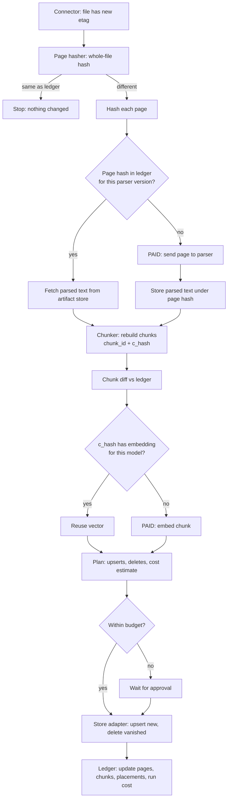
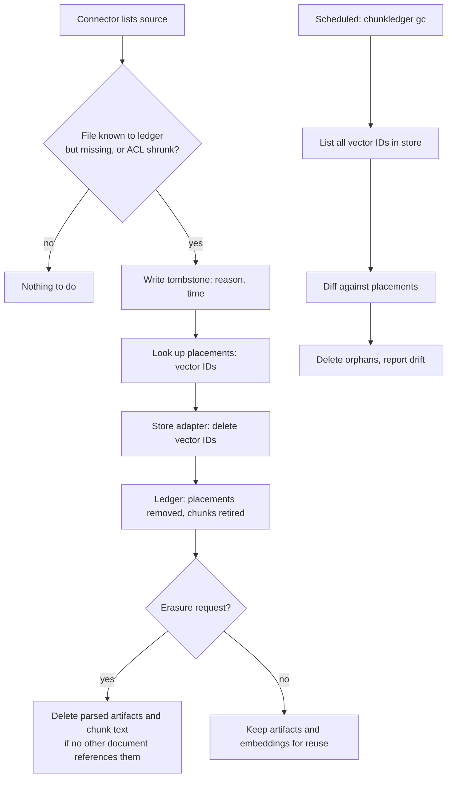
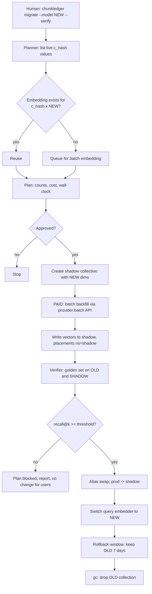
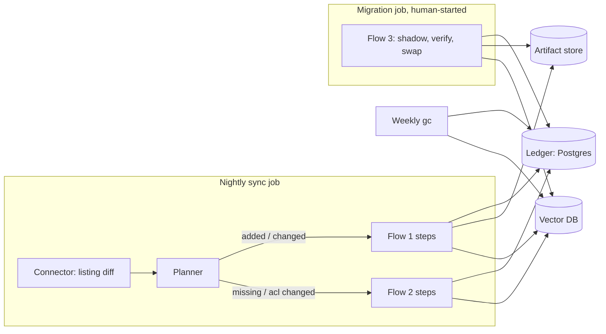
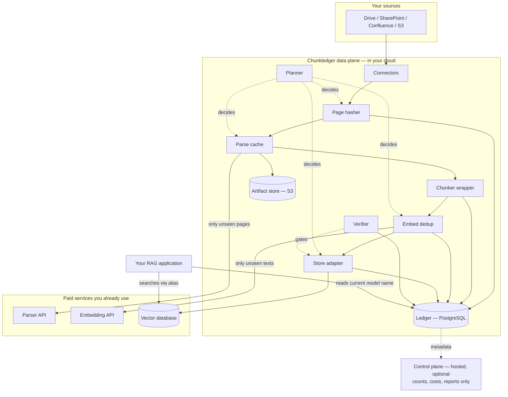

# Chunkledger flows explained and reviewed

*A product owner's guide to Flows 1, 2 and 3 — how they work, whether they are right, and what to decide.*

**Source of truth:** the research report *RAG cost reduction tool opportunity* (19 Oct 2026) and the architecture sections of the *Chunkledger educational video package*. Where this guide says **"Existing design"**, it describes what those documents propose. Where it says **"Recommendation"**, it is a change or addition I am proposing after reviewing the design; you decide whether to adopt it.

**How to read this.** Part 1 builds the mental model. Parts 2–4 teach each flow with one running example. Part 5 connects the flows. Part 6 is the senior-engineer review, with eleven problems found and fixes for each. Part 7 is your owner's toolkit: diagrams, responsibility map, decisions, glossary, and the one-paragraph pitch. Every technical term is defined the first time it appears, and collected again in the glossary.

---

## Part 1 — The big picture

### 1.1 The problem in one sentence

Companies that use AI to answer questions from their own documents keep paying to re-process documents that have not changed, keep deleted documents alive inside their search index, and treat small configuration changes as if the whole document collection were new. Chunkledger is a record-keeping layer that remembers what has already been done, so the system only does the new work.

### 1.2 What a RAG pipeline is, from zero

A **large language model (LLM)** is a program that takes text in and produces text out, one word-piece at a time. It knows what it was trained on, nothing more. It does not know your company's leave policy or last quarter's contract terms.

**Retrieval-Augmented Generation (RAG)** is the standard fix. Instead of hoping the model knows the answer, you first *retrieve* the few passages from your own documents that are relevant to the question, then hand those passages to the model together with the question, and the model writes the answer from them. The library analogy: you do not read the whole library to answer a question; you look in the index-card catalog, pull three relevant books, open them to the right page, and answer from there.

For that to work, your documents have to be prepared in advance. That preparation is called **ingestion**, and it has five stages:

1. **Parsing** — turning a file (PDF, Word, web page) into clean text. For PDFs with tables, scanned pages or complex layouts this is hard, and companies pay specialist services per page to do it well.
2. **Chunking** — cutting the text into passages of a few hundred words each. The model can only read a limited amount at once, and search works better on focused passages than on whole documents. A passage is called a **chunk**.
3. **Embedding** — turning each chunk into a long list of numbers (typically 1,536 of them) called a **vector**. Chunks with similar meaning get similar numbers. This is what makes "search by meaning" possible: the question is turned into a vector the same way, and the closest chunk-vectors are the most relevant passages. The program that produces these numbers is an **embedding model**, usually a paid API billed per million **tokens** (word-pieces; about 500 tokens per page).
4. **Storage** — saving the vectors in a **vector database** (pgvector, Qdrant, Pinecone, Weaviate) that can find the nearest vectors to a query quickly. Vectors are stored in a **collection** or **namespace**, the database's version of a table.
5. **Search** (query time) — when a user asks a question: embed the question, find the top-k nearest chunk vectors, optionally **rerank** them with a second model, assemble the chosen chunks into the model's input, and generate the answer.

Stages 1–4 happen when documents arrive or change. Stage 5 happens on every question. Chunkledger lives entirely in stages 1–4. It never touches stage 5.

### 1.3 Why these stages cost money and time

At October 2026 list prices (all **[VERIFIED]** in the report):

| Stage | Who bills you | Typical price | For 1,000,000 pages |
|---|---|---|---|
| Parsing | LlamaParse, Reducto, Unstructured, Azure | $1.25 to $56.25 per 1,000 pages | **$1,250 to $56,250** |
| Chunking | nobody (your own CPU) | ~free | ~$0 |
| Embedding | Voyage, OpenAI, Cohere, Google | $0.02 to $0.20 per million tokens | **$10 to $60** |
| Storage | the vector database | $0.33 per GB-month, plus charges per write and per read | a few dollars to a few hundred per month |
| Engineering time | your team | $50+ per hour | the biggest line of all: one itemized year-one budget puts labor at 72.5% of total RAG cost **[VENDOR CLAIM]** |

Two things in that table surprise most people. Embedding, which everyone talks about, is nearly free. Parsing, which nobody talks about, costs 20 to 1,000 times more than embedding for the same pages. And the labor to keep the pipeline in sync dwarfs both.

### 1.4 What goes wrong in a normal pipeline

The frameworks people build with (LangChain, LlamaIndex) and the cloud services (AWS Bedrock Knowledge Bases, Azure AI Search, Google Vertex) make three mistakes, all **[VERIFIED]** from their own documentation in the report:

**Mistake 1 — they think in whole documents.** When a 10-page PDF changes by one paragraph, they see "the file changed" and re-parse all 10 pages and re-embed all 20 chunks. LangChain's indexing API hashes chunks *after* splitting, so one inserted sentence shifts every later chunk boundary and every later chunk gets a new hash and a new embedding.

**Mistake 2 — they do not clean up deletions.** LangChain's incremental mode "will not remove sources that disappeared". Azure's indexers "don't track deletions". Vertex's import "handles additions and updates only". Delete a document from Drive and its chunks keep being retrieved for weeks. These leftover vectors are called **orphans**.

**Mistake 3 — a configuration change becomes a full rebuild.** Change the chunk size, upgrade the parser, or switch embedding model, and the entire corpus is re-parsed, re-chunked and re-embedded. Bedrock says chunking "cannot be changed after creation". Every vector-database vendor says a model swap means "re-embed everything behind an alias". Teams report one to three of these full rebuilds in their first six months **[VENDOR CLAIM]**.

### 1.5 How Chunkledger removes the unnecessary work

The core idea is called **content addressing**: identify every piece of derived data by a **hash** of its input. A hash is a short fingerprint (a 16-character string) computed from some bytes; the same bytes always produce the same fingerprint, and any change produces a different one. If you know the fingerprint of the input, you can check whether you already have the output.

Chunkledger keeps a **ledger** (a set of PostgreSQL tables) that records, for every document:

```
source (file in Drive)  →  document (file hash)  →  pages (page hashes)
  →  parsed artifacts (parsed text, keyed by page hash + parser version)
  →  chunks (chunk_id = where it lives, c_hash = fingerprint of its text)
  →  embeddings (c_hash × model → vector)
  →  placements (which vector database, which namespace, which vector ID)
  →  tombstones (what was deleted, when, why)
```

With that ledger, each stage can ask "have I already done this exact work?" before spending money:

- *Parse this page?* Only if its page hash is not in the ledger for this parser version.
- *Embed this chunk?* Only if its c_hash has no embedding for this model.
- *Write this vector?* Only if the placement row is missing or stale.
- *Delete these vectors?* Exactly the ones whose document got a tombstone.
- *Switch models?* Embed every live c_hash once with the new model, nothing more, and prove the result before switching.

The three flows are just the three different *triggers* that make the ledger do that arithmetic:

| Flow | Trigger | One-line purpose |
|---|---|---|
| **Flow 1** | A document changed (or is new) | Do the minimum parse, chunk, embed and write for what actually changed |
| **Flow 2** | A document disappeared or lost permissions | Remove its vectors, and reconcile the index against the ledger |
| **Flow 3** | You changed a setting (embedding model, chunker, parser) | Rebuild only the layer that setting affects, verify quality, switch over safely |

### 1.6 The running example

A company has **1,000 PDF documents**, 10 pages each, in a Google Drive folder. It uses LlamaParse (Cost-effective tier, $0.00375 per page **[VERIFIED]**), the embedding model `voyage-4` ($0.06 per million tokens **[VERIFIED]**), and Qdrant as the vector database. Chunks are about 250 tokens; two chunks per page. We will follow three events: the **first ingestion**, **one PDF edited**, and **one PDF deleted**, and later a **model swap**.

**First ingestion (before any flow saves anything).** Every page is new to the ledger, so the system does the full work once: 10,000 pages parsed ($37.50), 20,000 chunks embedded (5 million tokens, $0.30), 20,000 vectors written. The ledger now holds 1,000 document rows, 10,000 page rows, 10,000 parsed artifacts in object storage, 20,000 chunk rows, roughly 20,000 embedding rows (fewer if any chunk texts repeat across documents — boilerplate often does), and 20,000 placement rows. **This costs the same as without Chunkledger.** The savings begin with the second event. Keep that in mind; it is the single most important expectation to set with your buyers.

### 1.7 Three words that will keep coming up: control flow, data flow, work

- **Control flow** is *who decides what happens next*: the Planner reads the ledger, decides which pages to parse and which chunks to embed, writes a Plan, and workers execute it. Control flow is cheap: it is reads and writes in PostgreSQL.
- **Data flow** is *what bytes move where*: raw PDF bytes from Drive to the worker, parsed text from the parser to object storage, chunk text to the embedding API, vectors to the vector database. Data flow costs bandwidth and, where it crosses a paid API, money.
- **Work** is *the expensive processing itself*: the parser reading a page, the embedding model producing a vector, the vector database building its index. Chunkledger's whole purpose is to shrink **work** by spending a little more on **control flow**.

A good way to check any step in the flows below: ask "is this control, data, or work?" If it is work, ask "what hash was checked before doing it?"

---
## Part 2 — Flow 1: a document is new or edited

### 2.1 Purpose in plain language

Flow 1 answers one question: *"This document is different from what I have. What is the least I can pay to bring the search index up to date?"* It is the flow that runs most often — every night, or every few minutes — and it is where almost all the dollar savings come from.

### 2.2 When it starts

**Existing design:** a Connector lists the source (the Drive folder) on a schedule, compares what it sees with the ledger's `sources` table, and hands every new or changed file to Flow 1. "Changed" is detected cheaply first by the source's own change marker — the **etag** or modified time that Drive attaches to each file — and then confirmed by hashing the file bytes.

**Recommendation:** where the source offers a *change feed* (Google Drive Changes API, SharePoint delta queries, S3 event notifications), use it instead of a full listing. It is cheaper and, as we will see in Flow 2, much safer.

### 2.3 The numbered steps (the running example: one PDF edited)

Someone edits two paragraphs on page 7 of `policy-leave.pdf` and saves. That night:

1. **Connector** lists the folder. `policy-leave.pdf` has a new etag. It downloads the bytes (10 pages, ~2 MB) and passes `(uri, bytes, etag, acl)` to the Page hasher. *(control + data; no paid work)*
2. **Page hasher** computes the whole-file hash. It differs from `documents.raw_bytes_hash`, so the file really changed. It then splits the PDF into 10 pages locally and computes an **xxHash64** of each page's extracted text (for a scanned page, of its pixels). Nine hashes match the ledger's `pages` rows; page 7's hash is new. *(control; milliseconds; free)*
3. **Parse cache** looks up each page hash together with the parser identity: key = `(page_hash, parser_id, parser_version, params_hash)`. Nine keys hit — the parsed Markdown is already in object storage. One key misses: page 7 is sent to LlamaParse. The result is stored in object storage under its key, forever. *(work: 1 page parsed, $0.00375)*
4. **Chunker** rebuilds the document's chunks from the 10 parsed pages (9 from cache, 1 fresh). This is the customer's own splitter, wrapped so that every chunk gets two identities: `chunk_id` = hash of (document id + structural anchor such as the heading path or page number + position), and `c_hash` = hash of the chunk's normalized text. *(control; CPU only; free)*
5. **Chunk diff** compares the new set of `(chunk_id, c_hash)` pairs with the ledger's `chunks` rows for this document. Result: 17 chunks unchanged; 2 chunks on page 7 have the same `chunk_id` but a new `c_hash` (edited); 1 chunk has a new `c_hash` because its overlap window reaches into page 7. Nothing was added or removed. *(control; free)*
6. **Embed dedup** asks, for each of the 3 changed `c_hash` values: does `embeddings` already have a row for `(c_hash, voyage-4, 1024 dims)`? Perhaps one of the edited paragraphs now matches boilerplate that exists in another document — that one is reused. The other two are sent to the embedding API, in one batch. *(work: 2 chunks × 250 tokens = 500 tokens, $0.00003)*
7. **Planner / Plan.** In the existing design steps 2–6 are *computed first* as a Plan (a dry run that lists: parse 1 page, embed 2 chunks, upsert 3 vectors, delete 0, estimated cost $0.0038) and only then executed. For a nightly sync, approval is automatic under a configured budget; a plan over budget waits for a human. *(control)*
8. **Store adapter** upserts 3 vectors into Qdrant by their existing vector IDs (overwriting the old ones), and records the actual cost in `runs`. Had any `chunk_id` disappeared from the new set, its vector would be deleted here. *(work: 3 writes)*
9. **Ledger update.** `documents.raw_bytes_hash` is updated; `pages` gets page 7's new hash; `chunks` and `placements` are updated for the 3 chunks; the Plan is marked `applied` with estimated vs. actual cost. *(control)*

**Compare with a conventional pipeline for the same edit:** parse 10 pages ($0.0375), embed 20 chunks, write 20 vectors. Flow 1 paid for 1 page and 2 chunks. Multiply by 500 changed documents per night over 180 days and the parse line in the report's worked example falls from $3,375 to $675.

### 2.4 Mermaid flowchart



### 2.5 Component by component: what goes in, what comes out

| Component | Receives | Checks / computes | Sends on | Writes to |
|---|---|---|---|---|
| Connector | folder listing or change feed | etag vs `sources` | `(uri, bytes, etag, acl)` | `sources` |
| Page hasher | bytes | whole-file hash vs `documents`; per-page xxHash64 vs `pages` | list of `(page_no, page_hash, is_new)` | `pages` (new hashes) |
| Parse cache | page hashes + parser config | key `(page_hash, parser_id, parser_version, params_hash)` in `parsed_artifacts` | parsed text per page | object storage; `parsed_artifacts` |
| Chunker | parsed pages | runs the customer's splitter; derives `chunk_id`, `c_hash` | list of chunks | — |
| Chunk diff | new chunks + `chunks` rows | set difference | added / changed / removed lists | — |
| Embed dedup | changed `c_hash` list | `(c_hash, model, dims)` in `embeddings` | vectors (reused or new) | `embeddings` |
| Planner | all of the above | work list + cost from price table | Plan | `plans` |
| Store adapter | Plan | — | upsert / delete calls to the vector database | `placements`, `runs` |

### 2.6 What is stored where

- **PostgreSQL (the ledger):** only small facts — hashes, IDs, versions, timestamps, costs. About 200 bytes per chunk **[ASSUMPTION]**. In *hash-only mode* it holds no document text at all.
- **Artifact store (S3 / GCS / MinIO):** the parsed text of every page, named by its page hash and parser version. This is what makes "re-chunk without re-parsing" free.
- **Vector database:** the vectors plus whatever metadata the search needs (document id, chunk_id, ACL tags, source URL). It never holds the parsed artifacts.

### 2.7 Where hashes and cache keys are made and checked

| Hash | Made by | From | Checked against |
|---|---|---|---|
| `raw_bytes_hash` | Page hasher | whole file | `documents` |
| `page_hash` | Page hasher | one page's extracted text (or pixels) | `pages`; and as part of the parse-cache key |
| parse-cache key | Parse cache | `page_hash + parser_id + parser_version + params_hash` | `parsed_artifacts` |
| `chunk_id` | Chunker | `doc_id + structural anchor + ordinal` | `chunks` (identity) |
| `c_hash` | Chunker | normalized chunk text | `chunks` (change) and `embeddings` (reuse) |
| embedding key | Embed dedup | `c_hash + model_id + dims` | `embeddings` |

### 2.8 When work is skipped and when it is done

| Situation | Parse | Chunk | Embed | Write |
|---|---|---|---|---|
| File etag unchanged | skip | skip | skip | skip |
| File re-saved, no text change (new metadata only) | skip (page hashes match) | re-chunk (free) | skip | skip |
| One page edited | 1 page | all (free) | changed chunks only | changed only |
| Chunk-size setting changed (Flow 3 variant) | skip (all cached) | all (free) | all changed c_hash | all |
| Parser upgraded to a new version | **all pages** (new parser version = new key) | all | changed c_hash only | changed only |

That last row deserves attention: a parser *upgrade* is a legitimate full re-parse, because the output can differ. Chunkledger makes it cheap only when the chunk text comes out identical (then embedding is skipped).

### 2.9 Failures, retries and duplicates

- **Duplicate trigger** (the connector fires twice for the same file): the second run hashes everything, finds every hash already in the ledger, and does nothing. Content addressing makes repeats harmless — this property is called **idempotency**.
- **Parser call fails** (timeout, 500): retry with backoff; after N failures mark the page `parse_failed` and keep serving the *old* parsed artifact and old vectors, so the document never disappears from search because of a vendor outage. Alert.
- **Embedding API rate-limited:** the batch scheduler backs off and retries; nothing is written to the vector database until vectors exist.
- **Vector write fails after embedding succeeded:** the embedding is already saved in `embeddings`, so the retry costs nothing; the `placements` row stays `pending` until the write succeeds.
- **Worker crashes mid-plan:** on restart it re-reads the Plan; every step is keyed by hash, so finished steps are detected as done and skipped.
- **Document edited again while the plan is running:** see Problem 4 in Part 6 — the existing design does not say what happens, and it needs a rule.

### 2.10 A sample input and output

Input to Flow 1 (from the Connector):

```json
{"uri": "gdrive://folder-hr/policy-leave.pdf", "etag": "0x8DC9A1F", "bytes": "<2.1 MB>", "acl": ["group:all-staff"]}
```

Plan produced (dry run):

```json
{"doc_id": "d_7f3a", "pages_total": 10, "pages_to_parse": [7],
 "chunks_total": 20, "chunks_changed": 3, "chunks_to_embed": 2, "chunks_reused": 1,
 "upserts": 3, "deletes": 0,
 "estimated_cost_usd": {"parse": 0.00375, "embed": 0.00003, "writes": 0.0001, "total": 0.00388}}
```

Run record after apply:

```json
{"plan_id": "p_0192", "status": "applied", "actual_cost_usd": 0.00388, "wall_clock_s": 4.2}
```

### 2.11 Real-world scenario

The HR team edits the leave policy every few weeks, legal updates 40 contract templates each quarter, and engineering's Confluence space changes daily. In a conventional pipeline each of those edits re-parses whole documents, and the nightly sync bill scales with how big the documents are. With Flow 1 the bill scales with how many *pages* actually changed, and the nightly job finishes in minutes because it does almost nothing.

### 2.12 Is Flow 1 right? Short verdict

The logic is sound and it is the flow with the strongest evidence behind it (Notion runs exactly this kind of per-span hashing in production **[VENDOR CLAIM]**). It has four real caveats — page reflow, out-of-context parsing, non-deterministic chunkers, and concurrent edits — all covered in Part 6. None of them breaks the idea; all of them need a rule the current documents do not state.

---

## Part 3 — Flow 2: a document is deleted or loses permissions

### 3.1 Purpose in plain language

Flow 2 answers: *"Something that used to be in the index should no longer be there. Remove it, prove it is gone, and catch anything the other flows left behind."* It saves almost no money (about $3 a month in the report's example **[ASSUMPTION on volumes]**). It exists for **correctness and compliance**: a deleted contract or an HR document that was un-shared must stop appearing in answers.

### 3.2 When it starts

**Existing design:** two triggers. (a) The Connector's listing no longer contains a file the ledger knows, or the file's **ACL** (access-control list — who may see it) has shrunk. (b) A scheduled **garbage-collection** job, `chunkledger gc`, that compares the vector database's actual contents with the ledger's `placements` to find **orphans** (vectors nobody owns) and **drift** (the index being larger than the ledger says it should be).

### 3.3 The numbered steps (the running example: one PDF deleted)

HR deletes `policy-leave-2023.pdf` from the Drive folder.

1. **Connector** lists the folder tonight. The ledger's `sources` has `policy-leave-2023.pdf` marked live; the listing does not contain it. *(control)*
2. **Tombstone.** A row is written to `tombstones`: `source_id`, `reason = "missing_from_source"`, `observed_at = now`, `actor = connector`. Nothing is deleted yet. A tombstone is a *record of intent* — it is what an auditor will later read to see what was removed and why. *(control)*
3. **Placements lookup.** `placements` lists the document's 20 vector IDs in the Qdrant collection. *(control)*
4. **Store adapter** calls `delete(vec_ids)` on Qdrant. The 20 vectors are no longer returned by searches. *(work: 20 deletes, trivial cost)*
5. **Ledger update.** The 20 `placements` rows are marked `removed`; `chunks` rows are marked `retired` (not deleted — the ledger keeps lineage). `embeddings` rows are *kept*: another document may share a `c_hash`, and if the same text ever returns, its vector is free. *(control)*
6. **Artifact handling.** The parsed pages stay in object storage by default (another document may share a page hash, and if the file is restored it is free to re-ingest). If the deletion is a legal erasure request, see Problem 7 in Part 6. *(control)*
7. **Weekly `gc`.** Independently, the gc job asks Qdrant for all vector IDs in the collection, diffs them against `placements`, and reports: `orphans_in_store = 0, missing_in_store = 0, size_drift = 0%`. If it finds an ID the ledger does not know (say a developer wrote test vectors by hand, or a previous crash left a half-written document), it deletes it and logs it. *(control + a few deletes)*

### 3.4 Mermaid flowchart



### 3.5 Component by component

| Component | Receives | Does | Sends on | Writes to |
|---|---|---|---|---|
| Connector | listing / change feed | spots missing or ACL-reduced items | tombstone candidates | `sources` (last_seen) |
| Tombstone writer | candidates | records intent with reason and time | source ids | `tombstones` |
| Placements lookup | source ids | finds all vector IDs for the document | vec_ids | — |
| Store adapter | vec_ids | `delete(vec_ids)` | confirmation | `placements` (removed) |
| gc job | store `list_ids()` + `placements` | set difference, drift % | orphan list, report | `runs`, deletes in store |

### 3.6 What is stored where after a deletion

- **PostgreSQL:** the tombstone (permanent), placements marked removed, chunks marked retired, embeddings kept.
- **Artifact store:** parsed pages kept unless an erasure policy says otherwise.
- **Vector database:** the 20 vectors are gone. Note: most vector databases, including those built on **HNSW** (the common nearest-neighbour index), mark deleted vectors internally and reclaim the memory later during compaction. The vectors stop being *returned* immediately, but the storage bill may not drop until compaction runs. That is normal.

### 3.7 Permission changes — this is where the design is underspecified

A file is not deleted; it is *un-shared* from `all-staff` and now visible only to `group:hr`. What should happen?

**Existing design** says "ACL shrunk → tombstone candidate", which reads as "delete the vectors". That is only correct if *nobody* may see the document any more. In most RAG systems, permissions are enforced at **query time** by filtering on metadata ("only return chunks whose `acl` contains one of the asker's groups"). Under that model the right action is a **metadata update** of the 20 vectors' `acl` field — not a deletion.

**Recommendation:** make the permission model an explicit product decision (see Part 7), and give Flow 2 two branches: *ACL changed → update metadata on all placements (no re-embed)*; *ACL empty or file gone → tombstone and delete*. This is Problem 6 in Part 6.

### 3.8 Failures and dangerous cases

- **A listing fails half-way** (Drive API throttles, pagination breaks, the service account loses access to a sub-folder): the Connector sees hundreds of "missing" files. The existing design would tombstone and delete all of them. **This is the most dangerous failure in the whole product** — see Problem 5 in Part 6. The fix is a guard: never delete more than X% of a source in one run without human approval, and require a file to be missing in two consecutive listings before acting.
- **Delete call fails:** `placements` stay `pending_delete`; retried next run; `gc` catches anything that slips through.
- **File moved or renamed:** appears as one delete plus one add. Because all its page hashes and c_hashes already exist, the add costs nothing but placement writes. Run adds *before* deletes within a sync so the document never vanishes from search in between.
- **File restored from trash:** same as a move — free re-ingest, because the artifacts and embeddings were kept.

### 3.9 Sample input and output

Input: listing diff from the Connector:

```json
{"missing": ["gdrive://folder-hr/policy-leave-2023.pdf"], "acl_changed": [], "seen": 999}
```

Output: tombstone and gc report:

```json
{"tombstone": {"source": "gdrive://folder-hr/policy-leave-2023.pdf", "reason": "missing_from_source", "observed_at": "2026-10-20T01:00:12Z", "vectors_deleted": 20}}
{"gc_report": {"collection": "kb_prod", "store_ids": 19980, "ledger_live": 19980, "orphans_deleted": 0, "drift_pct": 0.0}}
```

### 3.10 Real-world scenario

A sales contract is terminated and the legal team deletes it. The next morning a salesperson asks the assistant about discount terms, and the old contract is no longer cited. Six months later, an auditor asks "when did this document leave the index, and why?" — the tombstone row answers in one query. Without Flow 2, the report documents cases of deleted content staying retrievable for days **[ANECDOTE]** and a team that found ~15 files silently missing from an index for weeks **[ANECDOTE]**.

### 3.11 Is Flow 2 right? Short verdict

The *mechanism* (tombstone → placements → delete → gc reconcile) is correct and simple. Two things are **not** right as written: deletion-by-absence needs a safety guard before it can be trusted in production, and "ACL shrunk" must not be treated the same as "deleted". Both fixed in Part 6.

---
## Part 4 — Flow 3: swapping the embedding model (and other configuration changes)

### 4.1 Purpose in plain language

Flow 3 answers: *"I want to change a setting that affects every chunk in the index. Rebuild only the layer that setting touches, prove the new index is at least as good as the old one, switch users over with no downtime, and keep a way back."*

The embedding-model swap is the headline case because it is the most painful one in the wild: Google's `text-embedding-004` was discontinued on 14 Jan 2026 and teams had to re-embed everything with no partial path **[ANECDOTE]**; a 493-point Hacker News thread called model change "the real problem in embedding data lifecycle management" **[ANECDOTE, large public signal]**. But the same flow handles a chunk-size change (rebuild chunks, keep parses) and a parser upgrade (rebuild parses, then everything downstream).

One honest framing from the report: Flow 3 does **not** avoid re-embedding on a model swap. Every live chunk gets embedded once with the new model (in the running example, 20,000 chunks, 5 million tokens, about $0.30 with voyage-4; $15 at the report's 1M-chunk scale **[VERIFIED prices]**). What it avoids is re-parsing ($37.50 here, $1,875 at scale), re-chunking, the multi-day manual process, the silent quality risk, and the downtime. Research that promises "translate old vectors to the new model without re-embedding" exists (vec2vec, Drift-Adapter) but is preprint-only and unreplicated **[VERIFIED as papers]**, so the product does not rely on it.

### 4.2 When it starts

**Existing design:** a human runs `chunkledger migrate --model voyage-4 --verify` (or changes the chunker/parser config and runs `plan`). Flow 3 never starts on its own.

### 4.3 The numbered steps (the running example: switch from `voyage-4` to a hypothetical `voyage-5`)

1. **Planner** reads the ledger: 20,000 live chunks, 19,400 distinct `c_hash` values (600 chunks share text with another chunk). It checks `embeddings` for `(c_hash, voyage-5)`: none exist. Plan: embed 19,400 texts, write 20,000 vectors to a new namespace, parse 0 pages, re-chunk 0 documents. Estimated cost at list price, estimated wall-clock given the provider's rate limit. *(control)*
2. **Approval.** You read the plan and approve. *(control)*
3. **Shadow namespace.** The Store adapter creates `kb_prod_v5` (in Qdrant, a new collection with the new model's dimensions; in pgvector, a new table — vector columns have a fixed size, so a model with different dimensions always needs a new table). The live alias `kb_prod` still points at the old collection. Users notice nothing. *(control)*
4. **Batch backfill.** The Embed dedup component sends the 19,400 chunk texts to the embedding provider's **batch API** (Voyage 33% off, OpenAI 50% off, slower turnaround **[VERIFIED]**), respecting rate limits. Each returned vector is saved in `embeddings` under `(c_hash, voyage-5)` and written to the shadow collection; a `placements` row with `namespace = kb_prod_v5` is created per chunk. *(work: the only paid step)*
5. **Verifier.** It loads the **golden set** — 50 to 200 real user questions, each with the chunk_ids a human confirmed as the right answers. It runs every question against the old collection and the shadow collection and computes **recall@k** (of the known-correct chunks, what fraction appear in the top k results) for each, plus **result overlap** (how similar the two result lists are). It writes a report: `old recall@10 = 0.91, new recall@10 = 0.93, overlap@10 = 0.71`. *(control + a few hundred cheap searches)*
6. **Gate.** If new recall is at or above the threshold you set (the report suggests ≥ 0.95 of the old value **[ASSUMPTION]**), the plan proceeds; otherwise it stops as `blocked` and nothing changes for users. Overlap is reported but not gated on: two good models legitimately return different lists, and the report's sources call overlap "a sanity check, not a quality guarantee" **[ANECDOTE]**. *(control)*
7. **Alias swap.** `kb_prod` now points at `kb_prod_v5`. In Qdrant this is one atomic alias operation; in pgvector it is `CREATE OR REPLACE VIEW`. Every search from this instant hits the new vectors. *(control)*
8. **Query-side switch.** The application must now embed *questions* with `voyage-5` too, or it will compare new-model vectors against old-model queries and get garbage. The existing design does not say how this happens — **see Problem 8**. *(control, critical)*
9. **Rollback window.** The old collection stays for 7 days (configurable). Rolling back is one alias swap in the other direction. Storage is doubled for that week (about $0.54 at the report's scale **[ASSUMPTION]**). *(control)*
10. **gc** deletes the old collection after the window and marks its placements removed. `embeddings` rows for `voyage-4` are retained or pruned per policy. *(control)*

### 4.4 Mermaid flowchart



### 4.5 Component by component

| Component | Receives | Does | Sends on | Writes to |
|---|---|---|---|---|
| Planner | migrate command + ledger | counts live c_hash; checks `embeddings` for new model; prices the work | Plan | `plans` |
| Store adapter | Plan | `create_namespace(new dims)`; later `swap_alias`; later `drop` | confirmations | `placements` |
| Embed dedup | c_hash list | batch API calls with backoff | vectors | `embeddings`, `runs` (actual cost) |
| Verifier | golden set + two collections | recall@k, overlap@k, threshold gate | report, pass/block | `golden_sets`, `plans.status` |
| gc | expiry of rollback window | drops old collection | — | `placements` |

### 4.6 Where the hashes are checked

Only one check matters here: `(c_hash, new_model, dims)` in `embeddings`. Because chunk identity (`chunk_id`) does not depend on the model, the golden set — which names expected chunks by `chunk_id` — stays valid across the swap. That is why **one change at a time** is a rule: if you change the chunker and the model together, chunk_ids change and the golden set can no longer be compared.

### 4.7 The chunk-size and parser-upgrade variants

| Change | What is rebuilt | What is reused | Paid work |
|---|---|---|---|
| Embedding model | embeddings, placements | parses, chunk texts | embed every distinct c_hash once |
| Chunk size / splitter | chunks, embeddings (for new c_hash), placements | parses (all from artifact store) | embed only chunks whose text is new; in practice most, since boundaries moved |
| Parser version | parses, then chunks, embeddings, placements | nothing above the parse layer; but embeddings reused wherever the chunk text comes out identical | re-parse every page; embed only changed c_hash |

All three run through the same shadow → verify → swap → rollback → gc sequence.

### 4.8 Failures

- **Backfill interrupted** (rate limit, outage, worker crash): resume from `embeddings` — every finished c_hash is already saved, so nothing is paid twice.
- **Verification fails:** plan `blocked`; the shadow collection is kept so you can inspect which golden questions regressed; the production alias never moved.
- **Alias swap fails half-way:** in Qdrant the alias operation is atomic; in pgvector the view replacement is transactional. Either the swap happened or it did not; the ledger records which.
- **Documents change during the backfill** (which can take hours or days at scale): **the existing design is silent** — see Problem 9. The shadow collection would fall behind the live one.
- **Query embedder not switched:** search quality collapses immediately after the swap, and nothing in the current design detects it — Problem 8.

### 4.9 Sample input and output

Command and plan:

```
$ chunkledger migrate --model voyage-5 --verify --rollback-days 7

Plan p_0310
  live chunks ............ 20,000   distinct texts ......... 19,400
  embeddings to create ... 19,400   (reused: 0)
  pages to parse ......... 0        documents to re-chunk .. 0
  shadow collection ...... kb_prod_v5 (1024 dims)
  estimated cost ......... $0.29 embed (batch), $0.08 writes
  estimated wall-clock ... 2 h 10 m at provider batch SLA
Approve? [y/N]
```

Verifier report:

```json
{"golden_queries": 120, "k": 10,
 "old": {"recall": 0.908}, "shadow": {"recall": 0.925}, "overlap": 0.71,
 "threshold": "shadow >= 0.95 * old", "result": "PASS",
 "regressed_queries": ["q_017", "q_088"], "improved_queries": 14}
```

### 4.10 Real-world scenario

Your provider announces that your embedding model will be retired in 90 days. Without Flow 3: an engineer writes a script, re-runs ingestion into a second index over two days, hard-codes the new model name in six places, flips a config on a Friday evening, and hopes **[ANECDOTE — this is a real post-mortem in the report]**. With Flow 3: one command, a cost plan you approve, a recall report you can show your manager, a switch at a time you choose, and a one-command rollback if a user reports worse answers on Monday.

### 4.11 Is Flow 3 right? Short verdict

The shape — shadow collection, golden-set gate, alias swap, rollback window — is the correct and industry-standard way to do this, and the vector databases already provide the primitives (aliases). Two gaps make it **incomplete as written**: it does not coordinate the *query side's* embedding model with the alias swap, and it does not say what Flow 1 does while a migration is in flight. Both are fixable and both are in Part 6.

---

## Part 5 — How the three flows work together

### 5.1 They are not three separate programs

A useful mental shift: **Flows 1 and 2 are two branches of one job**, the nightly *sync*. The Connector produces a listing diff — `added`, `changed`, `missing`, `acl_changed` — and the Planner turns each kind into work: added/changed → Flow 1 steps; missing/acl_changed → Flow 2 steps. **Flow 3 is a different kind of job** — a *configuration change* that a human starts — and it must coordinate with the sync job rather than run blindly beside it.



### 5.2 Which flow triggers which

| From | To | How |
|---|---|---|
| Connector diff | Flow 1 and Flow 2 | one Plan per sync run with both kinds of steps |
| Flow 1 | Flow 2 | a chunk that disappears inside an edited document is a *chunk-level deletion* — same delete call, no tombstone (the document still exists) |
| Flow 2 (move/rename) | Flow 1 | a file that reappears under a new URI is re-ingested at zero parse/embed cost |
| Flow 3 | Flow 1 | **while a migration is open, Flow 1 must write to both the live and the shadow collection** (Recommendation — see Problem 9) |
| Flow 3 | Flow 2 | after the rollback window, dropping the old collection is a Flow 2-style gc action |

### 5.3 Shared components and where responsibilities must stay separate

Shared by all three: the Ledger (PostgreSQL), the Store adapter, the Planner, and the `runs` cost record.

Must stay separate:

- **Only Flow 2 writes tombstones.** Flow 1 removing a vanished chunk is not a tombstone; a tombstone always refers to a *source*.
- **Only Flow 3 creates or drops collections and swaps aliases.** Flow 1 and 2 write into whatever the alias points to (and, during a migration, also the shadow).
- **Only the Verifier decides pass/block.** No other component may swap an alias without a verifier record, even for a "small" change.
- **Only the Planner prices work.** Workers execute; they never decide.

### 5.4 One complete end-to-end example

**Day 0 — connect.** You point Chunkledger at the Drive folder with 1,000 PDFs and run `chunkledger audit` against your *existing* Qdrant collection. Audit reads the collection's metadata and your source listing and reports: 20,410 vectors in the store vs 20,000 chunks the listing implies (2% drift — likely orphans from past deletions), 3 distinct embedding-model names found in metadata (a previous partial migration), and an estimated full re-index cost of $37.80 at list prices. No money spent; this is read-only.

**Day 1 — first ingestion through the ledger.** `chunkledger plan` says: parse 10,000 pages ($37.50), embed 19,400 distinct texts ($0.29), write 20,000 vectors. You approve. It runs for a few hours (parser throughput is the limit). The ledger is now populated; the artifact store holds 10,000 parsed pages. Cost: the same as a normal full ingest. **Savings: none yet.**

**Night 2 to night 180 — Flow 1 and 2 every night.** On an average night 10 documents change (1%), 1 is deleted, 1 is added. Plan: parse ~20 pages (20% of the changed documents' pages **[ASSUMPTION]**), embed ~30 chunks, upsert ~30, delete 20, add 20 (10 pages parsed for the new doc). Cost per night: around $0.12 instead of $0.41 for parsing 100 whole documents. The tombstone table grows by one row a night.

**Day 60 — chunk size change (Flow 3 variant).** The team wants 400-token chunks. Plan: parse 0 pages (all 10,000 cached), re-chunk 1,000 documents (free), embed ~12,500 new c_hash values ($0.19), write 12,500 vectors to a shadow collection. Verifier: recall@10 old 0.91, new 0.90 — passes a 0.95-ratio threshold. Alias swap. Without the ledger this change would have cost $37.50 in parsing plus a day of engineering.

**Day 120 — model swap (Flow 3).** As in Part 4. Cost $0.29 plus writes; wall-clock two hours on the batch API; one approval; one recall report; 7-day rollback.

**Day 127 — gc.** Old collection dropped. `gc` reports 0 orphans, 0% drift. The `runs` table now holds 180 nightly plans and 2 migrations with estimated vs. actual cost — the auditable savings ledger that the hosted control plane (if you use it) would display.

---
## Part 6 — Senior-engineer review: is the architecture correct?

**Overall verdict first.** The design is *directionally correct and buildable*. Content addressing is the right primitive; the three triggers are the right decomposition; the shadow-verify-swap pattern is the right way to change configuration. The documents do, however, leave eleven things unstated or wrong, and three of them (Problems 5, 8 and 9) would cause production incidents if built literally as described. None requires a redesign; all require a stated rule and a small amount of code.

Each problem below gives: what it is, why it matters, a concrete example, and the recommended fix. Items are grouped by the review questions you asked.

### Are the responsibilities of the three flows clearly separated?

**Problem 1 — Flows 1 and 2 are described as separate flows but are really one job.**
*Why it matters:* if engineers build two schedulers, two listing passes and two plan types, they will double the connector load and create ordering bugs (deletes landing before adds for a moved file).
*Example:* `contract-A.pdf` is moved to a new folder. Flow 2 runs first and deletes its 20 vectors; Flow 1 runs an hour later and re-adds them. For an hour, the contract is not searchable.
*Fix:* one sync job, one listing diff, one Plan containing both kinds of steps, executed in the order **adds → updates → metadata changes → deletes**. Keep "Flow 1" and "Flow 2" as names for the two branches, not as two programs.

### Is the content-hash and cache-key design sufficient?

**Problem 2 — Page-level hashing assumes edits stay on their page.**
*Why it matters:* the report's saving on the parse line (85% of the baseline) depends on the assumption that only ~20% of a changed document's pages change **[ASSUMPTION, no source]**. In reflowing formats — Word documents exported to PDF, HTML, Markdown — inserting a paragraph on page 3 pushes text onto pages 4, 5, 6… and every subsequent page gets a new hash. In the worst case, a one-line edit on page 1 re-parses the whole document, and Flow 1 saves nothing on parsing.
*Example:* a 40-page employee handbook maintained in Google Docs and exported to PDF. Adding one bullet on page 2 reflows 38 pages.
*Fix:* make the **hashing unit depend on the format**. For born-digital PDFs that are edited in place (forms, scanned-then-OCR'd files, print layouts), the physical page is right. For reflowing sources, hash by *structural section* (heading-delimited block) rather than page, and parse by section. Where the source is a Google Doc, DOCX or HTML, pull the structured text directly and skip the PDF parser entirely. Add a per-source setting `hash_unit = page | section` and have `audit` report, per source, what fraction of pages change when a document changes — that measured number replaces the unsourced 20%.

**Problem 3 — Parsing a single page out of context can produce different output than parsing the whole document.**
*Why it matters:* good parsers use neighbouring pages to join tables that span a page break, detect running headers and footers, and keep reading order. A page parsed alone may come out slightly different, so the cached artifact for page 7 (parsed in context) and a fresh parse of page 7 (parsed alone) may not match — producing spurious chunk changes and, occasionally, a broken table.
*Example:* a pricing table runs from the bottom of page 7 onto page 8. Only page 7 changed. Parsing page 7 alone loses the table's continuation row headers.
*Fix:* parse the changed page **plus its immediate neighbours** (page ± 1) and keep only the changed page's output, or parse the whole *section*. Record a `context_mode` in the parse-cache key so in-context and standalone parses are never confused. Accept the small extra cost (3 pages instead of 1) — it is still far less than 10.

**Problem 4 — The chunker must be deterministic, and the design never says so.**
*Why it matters:* `c_hash` only detects real change if the same input text always produces the same chunks. "Semantic chunkers" that call an LLM, or splitters that depend on a random seed, produce different boundaries on every run — every chunk looks changed every night, and Flow 1 re-embeds the whole corpus while believing it is saving money.
*Example:* a team uses an LLM-based "agentic chunker". Night one: 20,000 chunks. Night two, no edits: 20,000 "changed" chunks, $0.30 of embedding and 20,000 writes — for nothing.
*Fix:* state the requirement: the wrapped chunker must be a pure function of (parsed text, chunker config). Add a **determinism check** to `audit` (chunk the same document twice, compare). For non-deterministic chunkers, cache the chunker output keyed by (set of page hashes, chunker_config_hash) so it runs once per document version.

### Can parsing, chunking and embedding actually be skipped safely?

Yes for parsing and embedding, with the caveats above. Two further conditions are missing:

**Problem 4b — Embedding APIs silently truncate long inputs** **[ANECDOTE in report]**. Two chunks that differ only after the model's maximum input length have different `c_hash` values but identical embeddings; the ledger would pay twice. Minor cost, but it also means `c_hash` is not a perfect proxy for "the vector changed". *Fix:* normalize chunk text to the model's token limit before hashing (`c_hash` over the first N tokens), and flag chunks that exceed the limit in `audit`.

**Problem 4c — Concurrent edits during a plan.** The design computes a Plan from the ledger, then applies it. If the document changes again between plan and apply, the plan is stale. *Fix:* each Plan carries the `raw_bytes_hash` it was computed from; `apply` re-checks it and re-plans if it differs (optimistic concurrency). Cheap and standard.

### How does the system avoid stale or duplicate vectors?

**Problem 5 — Deletion by absence is unsafe without a guard. (Most serious finding.)**
*Why it matters:* Flow 2 treats "the listing did not contain the file" as "the file was deleted". Listings fail partially all the time: API throttling, pagination errors, an expired OAuth token for one sub-folder, a shared-drive permission change for the service account. The literal design would then tombstone and delete every vector for every file in the unreachable part — a self-inflicted mass deletion of the search index.
*Example:* Drive throttles the service account at 60% of a 1,000-file listing. The Connector reports 400 files missing. Flow 2 deletes 8,000 vectors. Monday morning, 40% of the knowledge base is gone and nobody knows why.
*Fix (three layers):* (1) **Threshold guard** — if more than X% (say 5%) of a source's documents are missing in one run, do not delete; mark the run `needs_review` and alert. (2) **Two-strike rule** — a file must be missing in two consecutive successful listings before it is tombstoned. (3) **Prefer change feeds** — Drive's Changes API and SharePoint delta queries report deletions explicitly, so absence is never inferred. The tombstone's `reason` field should record which evidence was used.

**Problem 5b — Ordering of writes within an update.** When a chunk's vector is replaced, if the delete lands before the upsert there is a brief window with no vector. *Fix:* upsert by the same vector ID (true replacement) wherever the store supports it; for genuinely removed chunks, delete only after all upserts in the plan succeeded.

### How are deletions and permission changes handled?

**Problem 6 — "ACL shrunk" is treated like deletion.**
*Why it matters:* permission filtering is usually done at query time via metadata. Deleting vectors because a document became *less* shared makes it disappear for the people who still may see it.
*Example:* the salary-bands document is restricted from `all-staff` to `group:hr`. The literal design deletes its vectors; HR can no longer find it either.
*Fix:* Flow 2 gets two branches — `acl_changed` → update the `acl` metadata on all placements (no re-embed, cheap), and `acl_empty | missing` → tombstone and delete. This depends on a product decision you must make: does the customer's RAG system filter permissions at query time (metadata), or does it keep one collection per audience? Chunkledger should support the metadata model first and document the per-audience model as a later option.

**Problem 7 — Erasure requests versus shared artifacts.**
*Why it matters:* the artifact store and the `embeddings` table are shared across documents on purpose (dedup). If a legal "right to erasure" request requires destroying a document's content, you cannot simply delete its page artifacts — another document might reference the same page hash (identical boilerplate pages are common). And in non-hash-only mode the ledger's `chunks` table holds the chunk text itself.
*Example:* a customer requests deletion of all data about them; one page of their contract is a standard terms page shared by 300 other contracts.
*Fix:* add **reference counts** to `parsed_artifacts` and `embeddings` (how many live chunks/documents point at each). Erasure deletes an artifact only when its count drops to zero; otherwise it is retained with a note that the requesting document no longer references it. Offer *hash-only mode* (no chunk text in the ledger) as the default for regulated customers. Make erasure an explicit `chunkledger erase --source …` command with its own audit record, separate from ordinary deletion.

### How do PostgreSQL and the vector database stay consistent when failures occur?

The documents say "the ledger is the source of truth" and "jobs are idempotent", which is the right principle. What is missing is the explicit state machine.

**Problem 8 — The query side's embedding model is not part of Flow 3's switch. (Serious.)**
*Why it matters:* after the alias swap, the application must embed *questions* with the new model. If it keeps using the old one, every search compares incompatible vectors and results are effectively random — while the migration report says "PASS". Nothing in the current design detects this.
*Example:* the alias flips to `kb_prod_v5` at 14:00. The chat application still calls `voyage-4` for queries. Users get nonsense answers until someone notices.
*Fix:* the ledger keeps a small **model registry**: `current_query_model` per collection alias. The application reads the model name from it (one line in the SDK: `chunkledger.query_model("kb_prod")`) or receives it via the alias's metadata. The alias swap and the registry update happen in the same transaction. As a safety net, the Verifier runs **one post-swap smoke query** through the application's actual query path and checks it returns the expected chunk; if not, auto-rollback.

**Problem 9 — Flow 1 does not know about an in-flight migration.**
*Why it matters:* a backfill at scale takes hours to days (the report cites >5 days wall-clock for 100M chunks at provider rate limits **[ANECDOTE]**). Meanwhile Flow 1 keeps updating the *live* collection. At swap time the shadow collection is missing every change made during the migration.
*Example:* a 3-day migration; 1,500 documents change during it; after the swap, those documents are stale or absent in the new collection until the next sync — and deleted documents reappear.
*Fix:* a `migrations` table with status `open`. While a migration is open, Flow 1 embeds each changed chunk with **both** models and writes to both collections; Flow 2 deletes from both. The Planner reads `migrations` at the start of every plan. Close the migration after the alias swap. This is a small amount of code and removes a whole class of inconsistency.

**Problem 10 — Placement state machine is implied, not specified.**
*Fix:* give `placements` an explicit status: `pending → written → verified → removed`, plus `failed` with a retry count and a dead-letter after N attempts. `gc` reconciles anything `pending` older than a threshold. This is the standard **outbox pattern** — the database records intent first, a worker performs the external write, and the record is updated after confirmation — and it is what makes "the ledger is the source of truth" actually true.

### Is the proposed MVP unnecessarily complex?

**Problem 11 — The 90-day MVP is too wide for two engineers.**
The report's day-90 scope includes: ledger + migrations, `audit`, `plan`/`apply` with page pre-hashing and the artifact cache, chunk dedup, tombstones, `migrate` with golden-set verification and alias cutover, **two** vector-store adapters, **two** framework adapters, and **three** parser adapters. That is nine integration surfaces plus the core.
*Why it matters:* every adapter is a maintenance commitment, and the first three paid engagements only need one path to work end to end.
*Fix (recommended MVP cut):* ledger + `audit` + `plan`/`apply` + `migrate` on **one** vector store (pgvector *or* Qdrant — pick whichever your first design partner uses), **one** framework adapter (LangChain), **one** paid parser (LlamaParse) plus Docling for free local parsing, and the Problem 5/8/9 safeguards. Add the second store, second framework and other parsers in days 91–180 as design partners demand them. Keep the quantization optimizer out, as the report already recommends.

### What is missing entirely?

- A **model registry** read by the query path (Problem 8).
- A **migrations** table coordinating Flows 1/2 with Flow 3 (Problem 9).
- **Deletion guards** and change-feed connectors (Problem 5).
- **Reference counting** for shared artifacts and embeddings (Problem 7).
- A **metadata-only update** path (Problem 6).
- **Plan versioning** against the file hash (Problem 4c).
- **Observability**: per-run metrics (pages parsed, chunks embedded, writes, deletes, estimated vs. actual cost, verifier recall) exported to Prometheus/OpenTelemetry — the report's control plane assumes these exist but never lists them.
- **Secrets and rate limiting** for parser and embedding API keys, and a **dead-letter table** for pages or chunks that keep failing. (The video package already flags these as recommendations.)

### Review scorecard

| Question | Verdict | Problems |
|---|---|---|
| Responsibilities separated? | Mostly; merge Flows 1 and 2 into one sync job | 1 |
| Hash / cache-key design sufficient? | Sound, but hashing unit and parse context must be format-aware; chunker must be deterministic | 2, 3, 4, 4b |
| Can parse / chunk / embed be skipped safely? | Yes with the above rules and plan versioning | 4c |
| Stale or duplicate vectors avoided? | Yes once deletion guards and write ordering are added | 5, 5b |
| Deletion and permissions handled? | Deletion yes; permissions no — needs the metadata branch and erasure semantics | 6, 7 |
| Postgres ↔ vector DB consistency on failure? | Principle right, mechanism unspecified; add registry, migrations table, placement state machine | 8, 9, 10 |
| MVP complexity? | Too wide; cut to one store, one framework, one paid parser | 11 |

---

## Part 7 — The product owner's toolkit

### 7.1 Simple overall architecture



### 7.2 Responsibility map

| Component | Owns | Never does |
|---|---|---|
| Connectors | reading sources; producing the listing diff (added / changed / missing / acl_changed) | parsing, hashing content, deleting anything |
| Page hasher | file and page (or section) hashes; deciding "which pages are new" | calling a parser |
| Parse cache | the parse-cache key; calling the parser only on a miss; storing artifacts | choosing the parser (that is config) |
| Chunker wrapper | running the customer's splitter; assigning `chunk_id` and `c_hash` | deciding whether to embed |
| Embed dedup | the `(c_hash, model, dims)` lookup; batching; calling the embedding API | writing to the vector database |
| Store adapters | upsert / delete / metadata update / create collection / swap alias / list IDs | deciding *what* to write |
| Planner | reading the ledger; computing minimum work; pricing it; producing a Plan; checking the file hash at apply time | executing external calls |
| Verifier | golden sets; recall@k and overlap; the pass/block decision; the post-swap smoke test | choosing thresholds (that is yours) |
| Ingestion ledger | all facts: hashes, versions, placements, tombstones, plans, runs, migrations, model registry | storing vectors or documents |
| Artifact store | parsed page text by content hash | anything else |
| gc | reconciling store vs. ledger; dropping expired collections; reference-counted erasure | tombstoning sources |
| Control plane | displaying plans, costs, reports; alerts | seeing document text, embeddings or prompts |

### 7.3 The three flows at a glance

| Flow | Trigger | Main paid work | Produces | Saves |
|---|---|---|---|---|
| 1 — new or changed document | listing diff: added / changed | parse only unseen pages; embed only new c_hash | updated vectors, updated ledger, a priced Plan and Run | parse dollars every night; engineering time |
| 2 — deleted or permission-changed document | listing diff: missing / acl_changed; weekly gc | a few deletes or metadata updates | tombstones, clean index, drift report | correctness and compliance (≈ $3/mo in dollars) |
| 3 — configuration change | human command (model, chunker, parser) | embed every distinct c_hash once (model); re-chunk only (chunker); re-parse all (parser) | shadow collection, recall report, alias swap, rollback window | the re-parse bill, days of engineering, downtime, silent quality loss |

### 7.4 Minimum architecture for the MVP (recommended cut)

1. PostgreSQL ledger with the eight core tables plus `plans`, `runs`, `migrations`, `model_registry`, and a `status` column on `placements`.
2. Object-storage artifact cache (S3-compatible; MinIO locally).
3. One Connector: a plain S3/Drive folder listing **with the two-strike and threshold deletion guards**.
4. Page hasher with `hash_unit = page | section`.
5. Parse cache with LlamaParse and Docling adapters, parsing changed page ± 1.
6. Chunker wrapper with a determinism check.
7. Embed dedup with batch scheduling and dual-write during open migrations.
8. **One** store adapter (pgvector or Qdrant) with metadata update and alias/view swap.
9. Planner with price table, plan versioning, budget auto-approval.
10. Verifier with golden-set recall@k gate and post-swap smoke test.
11. CLI: `audit`, `plan`, `apply`, `migrate`, `verify`, `gc`.
12. One framework adapter (LangChain `RecordManager`).

Not in the MVP: hosted control plane, second store, second framework, Reducto/Unstructured adapters, quantization optimizer, savings-share pricing.

### 7.5 Decisions that are yours versus your engineers'

**Product-owner decisions (they change what the product is):**
- Which vector store and which framework the MVP supports first (follow your first design partner).
- The permission model Chunkledger supports first: query-time metadata filtering (recommended) or per-audience collections.
- Deletion safety policy defaults: the threshold percentage and the two-strike rule — and whether customers may turn them off.
- Erasure semantics: hash-only mode as default for regulated customers; what "erase" guarantees.
- Verification thresholds offered as defaults (e.g. new recall ≥ 95% of old) and whether a swap can ever bypass the Verifier.
- Rollback window default (7 days) and who may approve plans over budget.
- Whether the hosted control plane exists in year one, and what metadata it may receive.
- Pricing tiers and whether `audit` is free.
- The honest claim in marketing: "savings start at the second change", "modeled, not measured".

**Engineering decisions (they change how it is built):**
- Hash function (xxHash64 vs BLAKE3), key encodings, table schemas and indexes.
- Queue implementation (Postgres `SKIP LOCKED` first), worker concurrency, batch sizes, backoff policies.
- How the chunker wrapper derives structural anchors per format.
- Parser context window (page ± 1 vs section) per format.
- Observability stack, secrets management, packaging.

### 7.6 Glossary

- **ACL (access-control list)** — who is allowed to see a document.
- **Alias** — a stable name (`kb_prod`) that points at whichever collection is live; swapping it switches all searches at once.
- **Artifact store** — object storage holding parsed page text, named by content hash.
- **Batch API** — a slower, discounted way to send many embedding requests at once.
- **Blue-green** — building the new version beside the old one and switching when ready; what Flow 3 does.
- **c_hash** — fingerprint of a chunk's text; changes only when the text changes.
- **Chunk** — a passage of a few hundred words, the unit of search.
- **chunk_id** — identity of a chunk by *where it lives* (document + section + position); stable when the text is edited.
- **Collection / namespace** — a vector database's table.
- **Content addressing** — naming derived data by the hash of its input, so you can check whether the output already exists.
- **Control flow / data flow / work** — who decides, what bytes move, what expensive processing runs.
- **Embedding** — a list of numbers representing meaning; produced by an embedding model.
- **etag** — a change marker a source attaches to each file; cheap first check for "did it change?".
- **Golden set** — real questions with human-confirmed correct chunks, used to measure retrieval quality.
- **Hash** — a short fingerprint of some bytes; same bytes, same fingerprint.
- **HNSW** — the common index structure vector databases use for fast nearest-neighbour search.
- **Idempotent** — safe to run twice; the second run changes nothing.
- **Ledger** — Chunkledger's PostgreSQL tables of facts about every derived artifact.
- **Orphan** — a vector in the database whose source document no longer exists.
- **Outbox pattern** — record intent in the database first, perform the external write, then confirm.
- **Placement** — the ledger's record that a given chunk's vector lives in a given store, namespace and vector ID.
- **Plan** — the Planner's list of minimum work with a cost estimate; applied only after approval.
- **RAG** — retrieval-augmented generation: find relevant passages first, then let the model answer from them.
- **Recall@k** — of the known-correct chunks for a question, the fraction that appear in the top k results.
- **Reference count** — how many live documents point at a shared artifact or embedding.
- **Shadow collection** — the new collection being built beside the live one during a migration.
- **Tombstone** — a permanent record that a source was removed, when and why.
- **Token** — a word-piece; about 500 per page.
- **Vector database** — storage that finds the nearest vectors to a query vector quickly.
- **xxHash64** — a very fast non-cryptographic hash, suitable for change detection.

### 7.7 How to describe Chunkledger to a non-technical person

> Companies that let staff ask an AI questions about internal documents have to prepare those documents first — extracting the text, slicing it into passages, and indexing it so the AI can find the right passage. The expensive part is the text extraction, which specialist services charge for by the page, and the painful part is keeping the index in step with documents that change, get deleted, or need re-indexing when the team upgrades a setting. Most systems redo all of that work whenever anything changes, and quietly leave deleted documents in the index.
>
> Chunkledger is a bookkeeping layer that remembers exactly what has already been processed. When a 10-page document changes on one page, it processes one page. When a document is deleted, it removes it from the index and can prove it did. When the team changes a setting, it rebuilds only the affected layer, checks that search quality has not dropped, switches over without downtime, and keeps a one-click way back. It does not replace any of the tools a company already uses; it sits between them and makes sure none of them is paid to do the same work twice.

### 7.8 What I would do next as owner

1. Adopt Problems 5, 8 and 9 as **non-negotiable MVP requirements** — they are the incident-makers.
2. Decide the permission model (Problem 6) before any adapter is written; it changes the vector metadata schema.
3. Cut the MVP to one store, one framework, one paid parser (Problem 11).
4. Make `audit` report the measured "fraction of pages changed per changed document" per source, so the 20% assumption becomes a number from the customer's own data.
5. Put the sentence "savings start at the second change" on the first page of the pitch.
