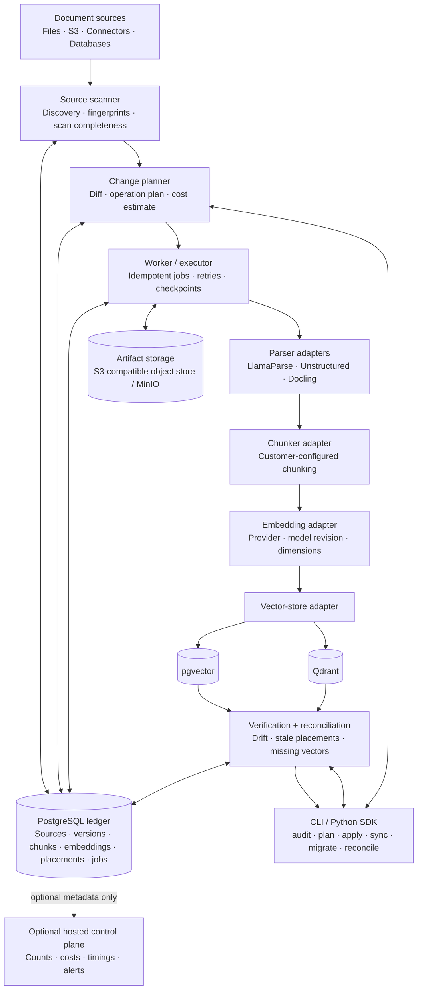
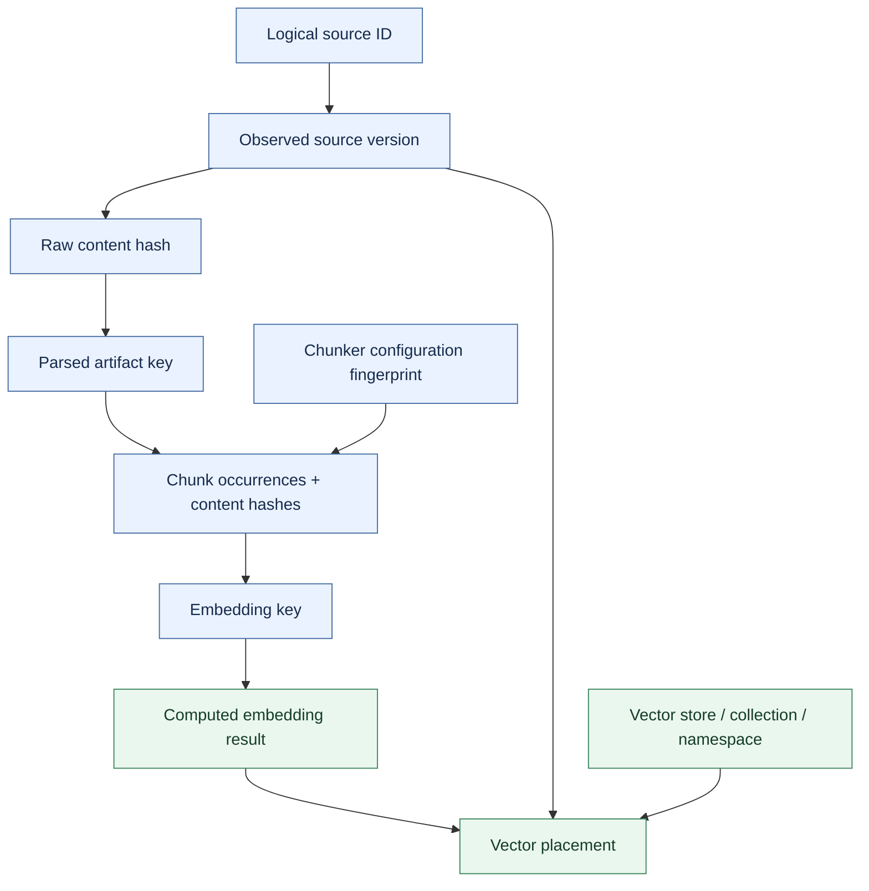
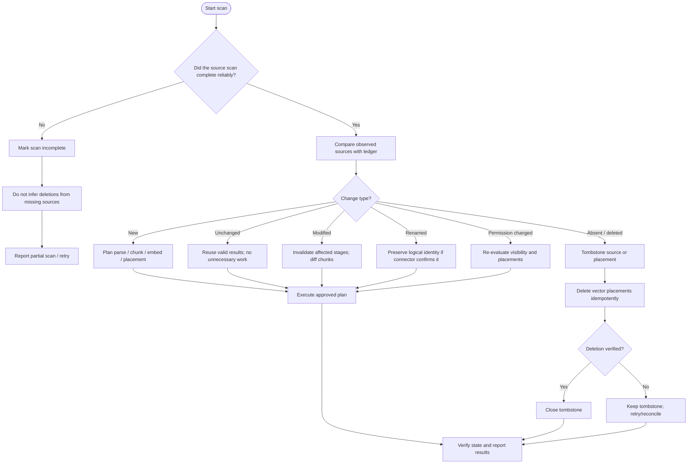
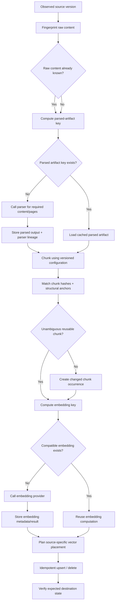
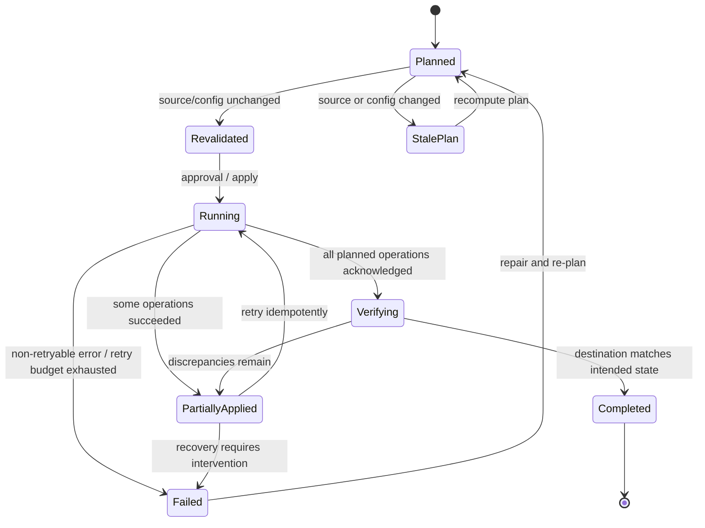
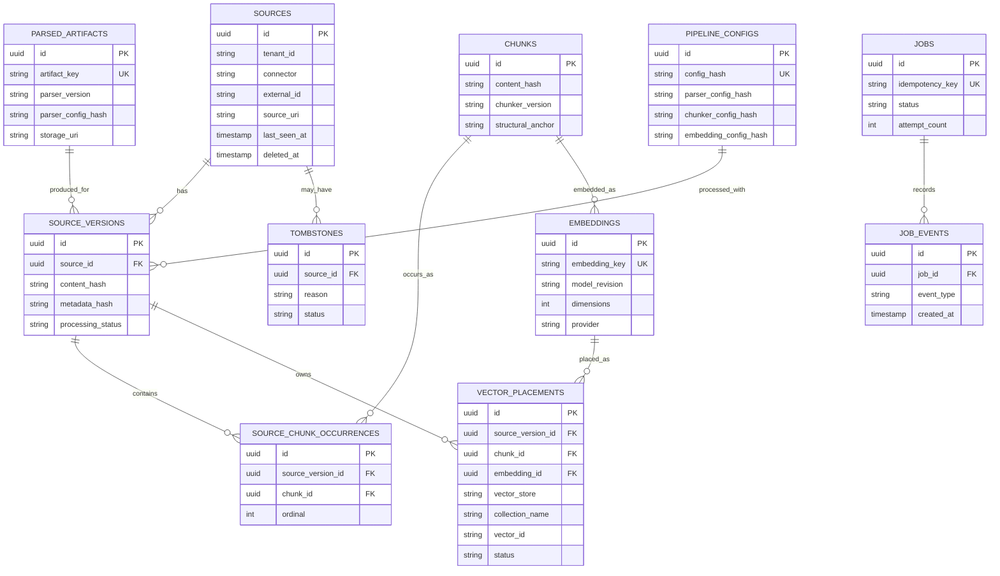
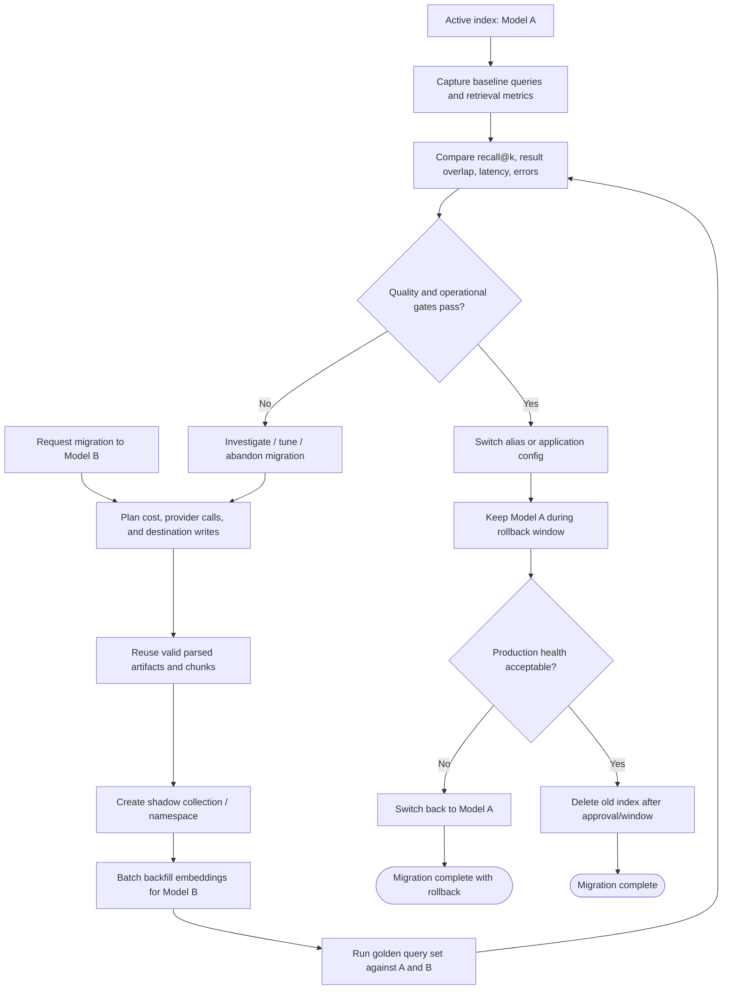
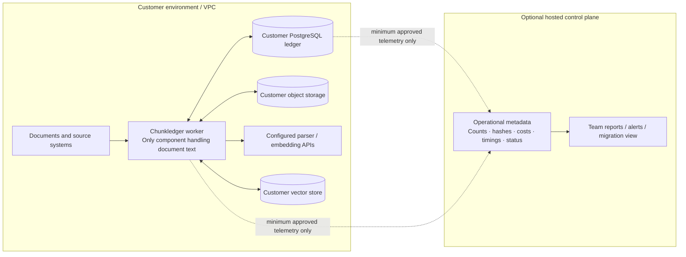
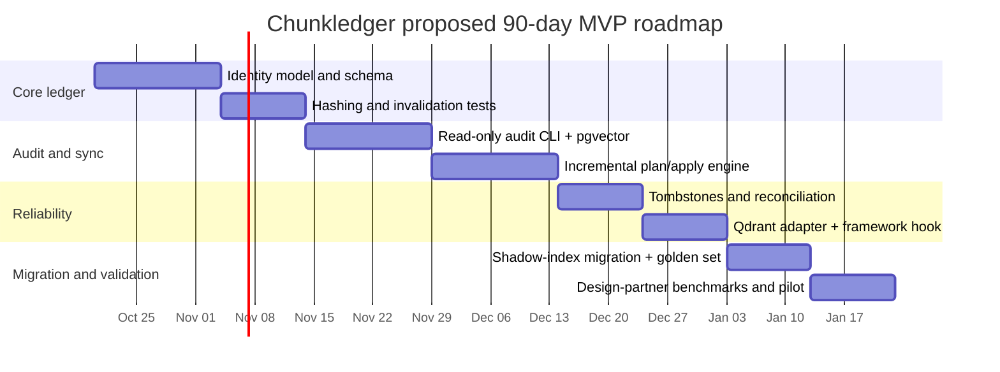
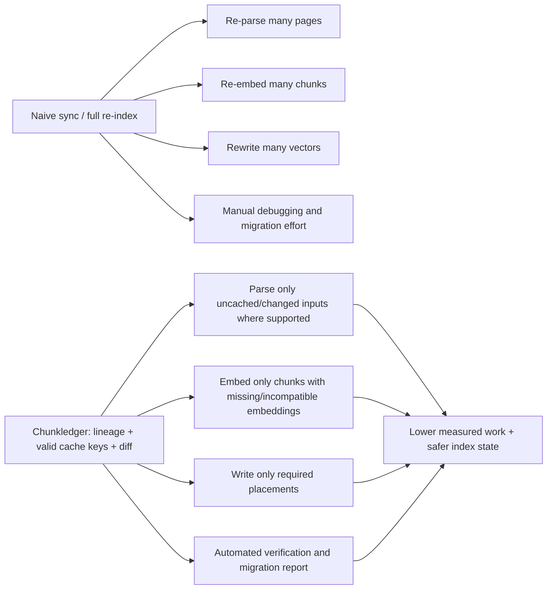

# Build the Chunk Ledger RAG Pipelines Lack

The one tool worth building is **Chunkledger: a content-addressed Chunk Ledger that sits between your document sources and your vector store, remembers every parsed page, chunk hash, embedding-model version and vector ID, and computes the minimum paid work for any change (an edit, a deletion, a chunking tweak, an embedding-model swap), then applies it and verifies retrieval parity before cutover.** The evidence confirms the direction the notes converge on, with one correction: the money is not in re-embedding (embedding 500M tokens costs $10–60 at Oct-2026 list prices [VERIFIED]) but in **re-parsing** (the same 500M tokens cost $1,250–$56,250 to parse [VERIFIED]) and in **engineering hours** (one itemized year-one RAG budget puts build labor at 72.5% and infrastructure at 1% [VENDOR CLAIM]), so the ledger must cache parsed artifacts first and dedupe embeddings second, and vendor-neutral quantization should be a 90-day-plus extension, not MVP scope. The gap is real and unoccupied: LangChain, LlamaIndex, Haystack, Bedrock, Vertex, Azure AI Search, Snowflake and Elastic all re-process at document (not chunk) granularity, most do not reconcile deletions, every vector-DB vendor tells users a model swap means "re-embed everything behind an alias," and the only attempts at chunk-level diff are two solo open-source projects with 0 and 2 GitHub stars plus a single-author preprint tested on 100 documents [VERIFIED]. Adjacent markets are saturated or collapsing (gateways consolidated into Palo Alto and Mintlify, three VC-backed routers pivoted, GPTCache abandoned, pgai Vectorizer archived), which is why the product must not be a gateway, cache, dashboard or vector DB. In a worked 180-day example (500k pages, 1%/day churn, two config-driven re-indexes) the baseline costs **$9,688 (₹8.14 lakh)** and the ledger-optimized pipeline **$2,388 (₹2.01 lakh)** including a $199/mo subscription, a 75% cut; the dollar savings are modest at this scale and scale linearly with parsed pages, while the labor and correctness savings (no orphaned deleted content, no silent mixed-model index) are what the buyer will actually pay for. A two-person team can ship the MVP (Postgres ledger + CLI + pgvector/Qdrant adapters + free index audit) in 90 days, and the fastest willingness-to-pay test is selling three fixed-fee embedding-model migrations to teams already complaining in public forums.

Label legend used throughout: **VERIFIED** = read on the primary page at the cited URL (list prices, docs, papers); **VENDOR CLAIM** = a vendor's own savings/performance statement or an interested party's estimate; **ANECDOTE** = a single practitioner's reported case; **ASSUMPTION** = a figure chosen for this report.

## Parsing and labor, not tokens, are where RAG money leaks

Per-unit prices have collapsed at every stage of the pipeline, which changes where waste lives. Embeddings cost **$0.02–0.20 per million tokens** (voyage-4-lite $0.02, voyage-4 $0.06, Cohere Embed 5 Pro $0.12, Gemini Embedding 2 $0.20) [VERIFIED] ([Voyage pricing](https://docs.voyageai.com/docs/pricing)), vector storage is **$0.33/GB-month** at Pinecone, turbopuffer and Chroma alike [VERIFIED] ([Pinecone pricing](https://www.pinecone.io/pricing.md); [Chroma pricing](https://www.trychroma.com/pricing)), and the cheapest frontier-adjacent LLMs (Claude Haiku 5.5, gpt-6-luna) are **$0.10 in / $0.50 out** per million tokens [VERIFIED] ([Claude pricing](https://platform.claude.com/docs/en/about-claude/pricing); [OpenAI pricing](https://developers.openai.com/api/docs/pricing)). Against that backdrop, document parsing is the single most price-dispersed stage: **LlamaParse runs from $1.25 per 1,000 pages (Fast) to $56.25 per 1,000 (Agentic Plus)**, a 45× spread, Reducto Parse is $10 per 1,000 pages and Unstructured $15 per 1,000 [VERIFIED] ([LlamaParse pricing](https://developers.llamaindex.ai/llamaparse/general/pricing); [Reducto pricing](https://reducto.ai/pricing); [Unstructured pricing](https://unstructured.io/pricing)). For a 1M-page corpus, parsing is a **$1,250–$56,250** bill versus **$10–$60** to embed the resulting 500M tokens, so parsing costs 20–1,000× more than embedding [VERIFIED, derived from the list prices above]. Crucially, every commercial parser bills per page submitted with no memory of whether that page was parsed before; LlamaParse's 48-hour re-parse cache is the only exception, and Unstructured's docs say change detection is available "but you must set them up yourself" [VERIFIED] ([LlamaCloud pricing](https://developers.llamaindex.ai/python/cloud/pricing); [Unstructured on usagepricing](https://usagepricing.com/blueprint/unstructured)).

The second leak is labor. A 2026 itemized year-one budget for a ~10M-vector, 5,000-query/day system puts **engineering build at $150,000 (72.5%)**, API spend at $18,000, maintenance and re-indexing at $25,000 and infrastructure at **$2,000 (1%)** [VENDOR CLAIM] ([dev.co](https://dev.co/rag-system-cost-year-one)); a separate agency estimate puts data preparation and ingestion pipelines at **40–50% of total engineering work** [VENDOR CLAIM] ([RaftLabs](https://www.raftlabs.com/blog/rag-development-cost)); and practitioner syntheses say the initial build is only 10–20% of lifetime cost, with "cleaning data, fixing ingestion pipelines, constant re-tuning across dozens of shifting data sources" as the hidden remainder [VENDOR CLAIM] ([kapa.ai](https://www.kapa.ai/blog/the-hard-part-of-rag-isn’t-retrieval-or-generation)). The specific recurring labor event is the full re-index: teams "typically trigger **1–3 full re-indexes in their first six months**" after chunking or embedding-model changes, and one post-mortem reported $50–600+ per sprint in re-indexing for a few-million-doc corpus [VENDOR CLAIM] ([Linkup](https://www.linkup.so/blog/the-real-cost-of-rag)). The default tutorial pattern is "delete, reload, re-chunk, and re-embed everything on any update," so compute scales with corpus size rather than change rate: a nightly re-index of 50,000 docs makes 50,000 embedding calls when hash-based detection at 1% daily churn would make 500 [VENDOR CLAIM] ([Linkup](https://www.linkup.so/blog/the-real-cost-of-rag)). Notion's production numbers are the strongest datapoint: hashing each span's text with 64-bit xxHash and re-embedding only changed spans produced a **70% reduction in data volume** and was part of a 90% two-year infrastructure cost reduction while scaling 10× [VENDOR CLAIM, first-party engineering blog] ([Notion](https://www.notion.com/blog/two-years-of-vector-search-at-notion)).

The table below ranks the ten stages by where dollars, latency and effort are actually lost at Oct-2026 prices, using the notes' reference workload (1M pages / 2M chunks / 100k queries per day) where a dollar figure is available.

| Stage | What is wasted | Evidence | Monthly $ at reference workload | Already fixed natively? |
|---|---|---|---|---|
| Parsing | Re-parsing unchanged pages on every sync or config change; wrong tier for low-value pages | 45× tier spread; 48-h cache only [VERIFIED] ([LlamaParse](https://developers.llamaindex.ai/llamaparse/general/pricing)) | $1,250–$56,250 per full pass, recurs per re-index [VERIFIED] | No (every parser bills per submitted page) |
| Chunking | Full re-chunk on any setting change; semantic chunking compute | Pharma case: 2 h → 8 h processing [ANECDOTE] ([Kothari](https://amitkoth.com/hidden-costs-rag/)); Bedrock chunking immutable post-creation [VERIFIED] ([AWS](https://docs.aws.amazon.com/bedrock/latest/userguide/kb-ds-update.html)) | Labor, not API dollars | No |
| Embedding | Re-embedding unchanged chunks; paying 6.5× for text-embedding-3-large for ~2–3 MTEB points | 100× fewer calls with hashing [VENDOR CLAIM] ([Linkup](https://www.linkup.so/blog/the-real-cost-of-rag)) | $3–18 incremental vs $10–60 full re-embed [VERIFIED] | Partially (document-level hashing in frameworks) |
| Vector storage/index | float32 when int8/binary gives 4×/32× at ~99%/~96% retained performance | Independent HF/MixedBread benchmark [VERIFIED] ([HF blog](https://huggingface.co/blog/embedding-quantization)) | $5–$14 storage on cheap hosts; $100–1,620 Pinecone reads [VERIFIED] ([Pinecone](https://www.pinecone.io/pricing.md)) | Yes inside each DB, off by default, irreversible once set in Weaviate [VERIFIED] ([Weaviate RQ](https://docs.weaviate.io/weaviate/configuration/compression/rq-compression)) |
| Hybrid search + rerank | Reranking 100 candidates at a flat per-search price | $2.00 per 1k searches [VERIFIED] ([Cohere](https://cohere.com/pricing)); p95 287–607 ms [VERIFIED, independent test] ([beri.net](https://www.beri.net/article/cohere-vs-voyage-vs-bge-reranker-per-search-vs-per-token-cost-2026)) | **$6,000** (exceeds the vector-DB bill on every vendor) [VERIFIED, derived] | No adaptive rerank-skip product exists [VERIFIED] ([Future AGI](https://futureagi.com/blog/best-ai-gateways-rag-pipelines-2026/)) |
| Query processing | Over-retrieval: retrieved context ~74% of input tokens, 3–5× more than used | [VENDOR CLAIM] ([Token Company](https://thetokencompany.com/blog/why-rag-token-costs-are-high)); kapa.ai pruned 68% of context at 96% recall, 34% net cost cut [VENDOR CLAIM, production] ([kapa.ai](https://www.kapa.ai/blog/how-we-prune-rag-context)) | Flows into LLM line | Research-stage; Adaptive-RAG classifier 54.5% accurate [VERIFIED] ([arXiv 2403.14403](https://arxiv.org/pdf/2403.14403)) |
| LLM inference | Flagship tier for easy queries; uncached static prefix | 20–100× price delta between tiers [VERIFIED] ([Claude pricing](https://platform.claude.com/docs/en/about-claude/pricing)); one audit cut input spend $8,000 → $1,400/mo in ~2 engineer-hours [ANECDOTE] ([Orzed](https://www.orzed.com/insights/prompt-caching-where-it-pays-back-and-where-it-does-not)) | **$1,680 (Haiku 5.5) to $168,000 (Fable 5.1)** [VERIFIED, derived] | Yes: provider prefix caching at 0.1× and free provider-native routing [VERIFIED] ([Claude caching](https://platform.claude.com/docs/en/build-with-claude/prompt-caching)) |
| Caching/dedup | Semantic cache false hits; no chunk-level embedding dedup | Static-threshold semantic cache: 2.5% wrong answers at 37% hit rate [VERIFIED, UC Berkeley] ([vCache](https://arxiv.org/pdf/2502.03771v4)) | 18–60% of RAG queries cacheable [VENDOR CLAIM] ([Portkey](https://portkey.ai/blog/reducing-llm-costs-and-latency-semantic-cache/)) | Prefix caching yes; semantic caching risky; embedding dedup only in a 2-star repo [VERIFIED] ([embedcache](https://github.com/Ajay6601/embedcache)) |
| Sync/updates/deletion | Orphan vectors after deletes; full re-embed on model change; chunk boundaries shift on edits | LangChain incremental "will not remove sources that disappeared" [VERIFIED] ([LangChain forum](https://forum.langchain.com/t/record-manager-vectorstore/1610)); orphans "persist for days" [VENDOR CLAIM] ([Redis](https://redis.io/blog/rag-at-scale/)) | $20–80 API dollars; the cost is labor and correctness | No cross-store tool; pgai archived Feb 2026 [VERIFIED] ([pgvector landscape](https://api.pgxn.org/src/pg_trickle/pg_trickle-0.46.0/blog/pgvector-tooling-landscape.md)) |
| Infra/observability | Dashboards that see spend daily and never act; retrieval spans not billed or attributed | Datadog bills only LLM spans [VERIFIED] ([dev.to](https://dev.to/mr_manushukla/datadog-llm-observability-pricing-2026-6-levers-that-cap-the-bill-3215)); first invoices 2–3× modeled [ANECDOTE] ([Enterprise DNA](https://enterprisedna.co/resources/blog/practitioner-rag-in-production)) | $150–700 tooling | Crowded with visibility tools |

Two conclusions follow. First, for a high-query-volume chatbot the LLM line dominates (50–95% of recurring spend) and the fixes are configuration-level and already free from the providers, which is bad territory for a startup. Second, for a document-heavy enterprise knowledge base the controllable money is parsing and the controllable effort is sync and re-indexing; neither has a native owner, and both compound every time the team changes a parser, a chunker or an embedding model.

## Every stage has a crowded field except the one after first ingest

The serving side consolidated in 2026 and the survivors give their cost features away. Palo Alto Networks announced the acquisition of Portkey [VERIFIED] ([NAND Research](https://nand-research.com/palo-alto-networks-portkey-acquisition-anchors-its-agentic-security-stack/)); Helicone joined Mintlify and entered maintenance mode [VERIFIED] ([Helicone](https://www.helicone.ai/blog/joining-mintlify)); Unify pivoted to continual learning, Martian became a research lab, TensorZero ($7.3M seed in Aug 2025) is archived, OpenPipe retired [VENDOR CLAIM, competitor-compiled, partially independently confirmed via unify.ai and withmartian.com] ([Standard Compute](https://standardcompute.com/alternatives/discontinued-ai-gateways)). OpenRouter's Auto Router is free and ranks models by what the community spends on each task type, with no benchmark support [VERIFIED] ([OpenRouter docs](https://openrouter.ai/docs/features/model-routing)); Bedrock, Azure and OpenAI ship passthrough-priced routers; LiteLLM has 61.3k stars under MIT [VERIFIED] ([GitHub](https://github.com/BerriAI/litellm)). The one peer-reviewed routing result (RouteLLM) showed routers trained on chat-arena data "perform near random" on out-of-distribution MMLU [VERIFIED] ([LMSYS](https://lmsys.org/blog/2024-07-01-routellm)), which is what RAG traffic looks like relative to chat data. Semantic caching is stuck between high hit rate and wrong answers: static thresholds gave **1.7–2.5% wrong answers at ~37% hit rate**, and correct and incorrect hits had near-identical similarity distributions (means 0.84 vs 0.85) [VERIFIED] ([vCache](https://arxiv.org/pdf/2502.03771v4)); GPTCache's last release was Aug 2024 and its maintainers "no longer add support for new API or models" [VERIFIED] ([GPTCache](https://github.com/zilliztech/GPTCache)). Prompt compression (LLMLingua-2) loses 1.6–4.9 LongBench points at 3–5× [VERIFIED] ([arXiv 2403.12968](https://arxiv.org/pdf/2403.12968)) and a 30,000-experiment 2026 study found it "often added overhead" under vLLM or commercial APIs [VERIFIED] ([Kummer et al.](https://www.alphaxiv.org/abs/2604.02985.md)). Observability and FinOps tools (Langfuse, LangSmith at $2.50/1k traces, Datadog from $160/mo per 100k spans, Finout, Vantage, CloudZero, Ascerta with its $18M Series A) all measure and alert; none act on retrieval, and Ascerta's cited customer savings came from manual follow-up [VERIFIED] ([GeekWire](https://www.geekwire.com/2026/pay-i-rebrands-as-ascerta-and-raises-18m-to-help-enterprises-track-ai-business-value/)). Entering any of these is entering a market where the incumbent price is zero or the category is being absorbed into security and docs vendors.

The ingestion side is crowded at the front (parsing) and the bundle (managed RAG) but empty in the middle. The stage-by-stage landscape:

| Stage | Open source | SaaS / cloud | 2025–26 startups | Pricing (list) | Claimed vs verified | Structural weakness |
|---|---|---|---|---|---|---|
| Parsing | Docling 69.1k★ MIT, Marker ~40.5k★ (weights RAIL-M, free under $5M revenue), MinerU ~30k★ [VERIFIED] ([Docling](https://github.com/docling-project/docling); [Marker](https://ossinsight.io/analyze/datalab-to/marker)) | LlamaParse, Reducto, Unstructured, Azure DI, Contextual Parse ($3–40/1k pages) [VERIFIED] ([Contextual](https://contextual.ai/pricing)) | Reducto $24.5M Series A (Benchmark, Apr 2025) [VERIFIED] ([Fortune](https://www.fortune.com/2025/04/25/exclusive-reducto-ai-document-parsing-startup-raises-24-5-million-series-a-led-by-benchmark)); Chunkr YC W24, PyPI client stale since Aug 2025 [VERIFIED] ([PyPI](https://pypi.org/project/chunkr-ai/)) | $1.25–$60 per 1k pages [VERIFIED] | Accuracy claims vendor-run (Reducto 90.2% vs Azure 82.7% on its own RD-TableBench [VENDOR CLAIM] ([Reducto](https://reducto.ai/blog/sota-table-parsing))); only Marker/MinerU/PaddleOCR have third-party OmniDocBench scores [VERIFIED] ([devtoollab](https://devtoollab.com/blog/best-pdf-parsers-for-rag)) | Billed per page submitted, no memory of prior parses |
| Chunking | Chonkie 4.8k★ MIT; company pivoted to Feyn (model training) [VERIFIED] ([Chonkie](https://github.com/chonkie-inc/chonkie); [usefeyn.com](https://usefeyn.com/)); Jina late chunking (research repo) [VERIFIED] ([arXiv 2409.04701](https://arxiv.org/abs/2409.04701)) | Built into every framework and cloud KB | Chonkie $500K pre-seed, then pivot [VERIFIED] ([vcbacked](https://www.vcbacked.co/company/chonkie)) | Free | Chonkie FastChunker "100+ GB/s" has no published comparison [VENDOR CLAIM] ([Chonkie docs](https://docs.chonkie.ai/oss/chunkers/overview.md)) | Not a venture business; no product handles what happens when a document changes |
| Embedding | bge/e5 on DeepInfra at $0.005–0.01/M [VERIFIED] ([DeepInfra](https://deepinfra.com/pricing)) | Voyage, OpenAI, Cohere, Google, Jina, Pinecone Inference | None found with embedding-reuse pitch | $0.02–0.20/M; batch 33–50% off [VERIFIED] ([Voyage](https://docs.voyageai.com/docs/pricing)) | Matryoshka: text-embedding-3-small at 512 dims retains 98% NDCG@10 [VERIFIED, independent] ([Castillo](https://dylancastillo.co/posts/matryoshka-vs-pca)) | Too cheap to be a cost problem; the problem is which calls you make |
| Vector storage/index | pgvector (halfvec 50% storage [VERIFIED] ([Neon](https://neon.com/blog/dont-use-vector-use-halvec-instead-and-save-50-of-your-storage-cost))), Qdrant, Milvus, Weaviate, Chroma, LanceDB | Pinecone ($50 min; RU $16–27/M), turbopuffer ($1/PB queried, 1.28 GB min/query, Launch $16/mo), Zilliz, Weaviate Cloud (Flex $45 min) [VERIFIED] ([turbopuffer changelog](https://turbopuffer.com/docs-md/pricing-log.md); [Weaviate](https://weaviate.io/pricing)) | turbopuffer (customers Notion, Anthropic, Linear) [VERIFIED] ([turbopuffer](https://turbopuffer.com/)) | $0.33/GB-mo storage; reads dominate on Pinecone | Quantization: Qdrant 0.98 recall@100 at 32× with 4× oversampling [VENDOR CLAIM] ([Qdrant](https://qdrant.tech/documentation/manage-data/quantization/index.md)); pgvectorscale "75% less cost" vs Pinecone not recall-matched [VENDOR CLAIM] ([TigerData](https://www.tigerdata.com/blog/pgvector-vs-pinecone)); serverless bills ~10× calculator in one competitor test [VENDOR CLAIM] ([Zilliz](https://zilliz.com/blog/the-cost-of-consequence-what-no-one-tells-you-about-serverless-vector-databases)) | Vectorizer/dimension immutable per collection (Weaviate, Chroma) [VERIFIED] ([Weaviate forum](https://forum.weaviate.io/raw/8661); [Chroma FAQ](https://cookbook.chromadb.dev/faq)) |
| Rerank | bge-reranker-v2-m3 Apache-2.0 (~$587/mo on one L4) [VERIFIED] ([beri.net](https://www.beri.net/article/cohere-vs-voyage-vs-bge-reranker-per-search-vs-per-token-cost-2026)) | Cohere $2–2.50/1k searches; Voyage $0.02–0.05/M tokens; Jina $0.05/M; ZeroEntropy $0.025/M [VERIFIED] ([ZeroEntropy](https://docs.zeroentropy.dev/models.md)) | ZeroEntropy | Flat vs token-priced: 4× spread at 100 candidates | Latency 287–607 ms p95 independently measured [VERIFIED] | Nobody skips reranking adaptively |
| Managed sync / RAG-as-a-service | pgai Vectorizer archived Feb 26 2026 [VERIFIED] ([pgvector landscape](https://api.pgxn.org/src/pg_trickle/pg_trickle-0.46.0/blog/pgvector-tooling-landscape.md)) | Bedrock KB, Vertex RAG Engine, Azure AI Search, Snowflake Cortex Search, Vectorize ($99–399/mo), Ragie ($100–500/mo + **$250/mo per extra connector**) [VERIFIED] ([Ragie](https://www.ragie.ai/pricing); [Vectorize](https://blog.vectorize.io/pricing)) | Captain YC W26 (~$295–1,600/mo), Needle $2.2M seed, Paragon Managed Sync (Jul 2026) [VERIFIED] ([Captain](https://yespress.io/captain-yc-w26); [Paragon](https://www.useparagon.com/blog/rag-freshness-incremental-sync-deduplication)) | Per page + per connector + idle serving (Snowflake ~6.3 credits/GB/mo even with no queries) [VERIFIED] ([Snowflake](https://docs.snowflake.com/user-guide/snowflake-cortex/cortex-search/manage-search-costs)) | Ragie "detects new, updated, and deleted files" every 4 h [VERIFIED] ([Ragie docs](https://docs.ragie.ai/docs/connections)); Vectorize docs say nothing about skipping unchanged documents [VERIFIED] ([Vectorize docs](https://docs.vectorize.io/)) | Metered per page processed, so no incentive to minimize re-processing; chunking/parser/model locked after creation |
| Gateways / caching / routing | LiteLLM 61.3k★; GPTCache dormant; LLMLingua 6.7k★ active | OpenRouter (5.5% credit fee), Cloudflare (free core), Kong, TrueFoundry ($25/user/mo), Bifrost [VERIFIED] ([Activepieces](https://www.activepieces.com/blog/understanding-openrouter-pricing-2026-and-fees.md); [TrueFoundry](https://truefoundry.com/pricing)) | Not Diamond repriced to $0.05/M tokens routed (Sep 2026) [VERIFIED] ([PricingSaaS](https://pricingsaas.com/companies/notdiamond)); Requesty claims 40–80% savings with no methodology [VENDOR CLAIM] | Free to 5–8% of spend | No commercial router publishes independently verified savings [VERIFIED, absence across ~70 pages] | Providers give caching and routing away; category consolidating |
| Observability / FinOps | Langfuse | LangSmith $2.50/1k traces, Datadog $160/mo per 100k spans, Helicone $79/$799, Amnic 0.25–1% of spend, CloudZero five figures/yr [VERIFIED] ([Amnic](https://amnic.com/blogs/ai-cost-optimization-tools-for-startups); [Helicone pricing](https://www.helicone.ai/pricing)) | Ascerta $18M A (Sep 2026), Carrot Labs YC W26 [VERIFIED] ([YC](https://www.ycombinator.com/companies/carrot-labs)) | Seat / log / % of spend; none on savings | All "dashboards plus alerts"; "No tool targets retrieval-stage cost" [VERIFIED] ([Spheron](https://www.spheron.network/blog/rag-cost-per-token-embedding-retrieval-and-generation-broken/)) | Cannot see parse/chunk/embed/index events at all |

The empty cell is the row that does not appear: nobody sells the derived-data bookkeeping between source and index. Investor money went to parsing accuracy (Reducto) and bundles (Captain, Ragie); the only artifacts attempting chunk-level diff with embedding reuse are ragversion (**0 stars, 0 forks, 20 commits**) and embedcache (**2 stars**) [VERIFIED] ([ragversion](https://github.com/sourangshupal/ragversion); [embedcache](https://github.com/Ajay6601/embedcache)) plus LiveVectorLake, a preprint evaluated on 100 synthetic documents [VERIFIED] ([arXiv 2601.05270](https://arxiv.org/abs/2601.05270)). That is either an unserved need or evidence of no demand; the next section argues the demand evidence is strong enough to bet on, with the caveat that the two solo projects also did no marketing.

## The unserved gap is a content-addressed Chunk Ledger

Three separately documented failures turn out to be one missing primitive. First, **chunk-level diffing with boundary-stable identity**: LangChain's indexing API hashes `page_content` after splitting, so any upstream edit that shifts a chunk boundary produces new hashes and re-embeds every affected chunk [VERIFIED] ([langchain_core source](https://raw.githubusercontent.com/langchain-ai/langchain/master/libs/core/langchain_core/indexing/api.py)); LlamaIndex's upsert lookup is by `ref_doc_id`, so comparison is per source document, not per chunk, and there is "no direct way to update nodes in a pipeline without changing the document" [VERIFIED] ([LlamaIndex API](https://developers.llamaindex.ai/python/framework-api-reference/ingestion/); [LlamaIndex community](https://community.llamaindex.ai/im-trying-to-update-the-nodes-of-a-document-that-is-stored-in-the-chroma-db-how-do-i-do-9JzqTKwgNGPk)). Paragon, an iPaaS vendor that just launched a sync product, names the gap it does not fill: "Record-level hashes can't show which chunk changed, so small edits trigger full re-embeds. Positional chunk IDs also break when chunking settings change" [VENDOR CLAIM] ([Paragon](https://www.useparagon.com/blog/rag-freshness-incremental-sync-deduplication)). Second, **deletion reconciliation**: LangChain's incremental mode "will not remove sources that disappeared" [VERIFIED] ([LangChain forum](https://forum.langchain.com/t/record-manager-vectorstore/1610)); LlamaIndex's `UPSERTS_AND_DELETE` fails against LanceDB in a GitHub discussion open and unanswered since April 2024 [VERIFIED] ([llama_index #12898](https://github.com/run-llama/llama_index/discussions/12898)); Haystack's document store does not recalculate IDs when a document changes and has no deletion sync [VERIFIED] ([Haystack](https://docs.haystack.deepset.ai/docs/document-store)); Azure AI Search "indexers don't track deletions" and a soft-delete policy "must be in place from the first indexer run" [VERIFIED] ([Microsoft Learn](https://learn.microsoft.com/en-us/azure/search/search-howto-index-changed-deleted-blobs)); Vertex RAG Engine's `import_files` "handles additions and updates only," and one team found ~15 files silently missing for weeks and built their own reconciliation diff [ANECDOTE] ([Classmethod](https://dev.classmethod.jp/en/articles/vertex-ai-rag-engine-kb-sync-pitfalls/)); Oracle's July 2026 guide recommends building a reconciliation job over source IDs, chunk hashes, deleted flags and embedding-model IDs and presents no product [VERIFIED] ([Oracle](https://blogs.oracle.com/developers/how-to-detect-rag-index-drift-deleted-docs-stale-chunks-and-duplicate-embeddings)). Third, **config-change amplification**: Bedrock's chunking strategy "cannot be changed after creation" and requires re-creating the data source [VERIFIED] ([AWS](https://docs.aws.amazon.com/bedrock/latest/userguide/kb-ds-update.html)); Snowflake re-embeds a row on "any change to a value," even when the search text is unchanged, and any schema change forces a full re-embed [VERIFIED] ([Snowflake](https://docs.snowflake.com/user-guide/snowflake-cortex/cortex-search/manage-search-costs)); Elasticsearch re-runs inference on all `semantic_text` fields on a full document update "even if their values did not change" [VERIFIED] ([Elastic](https://docs-v3-preview.elastic.dev/elastic/docs-builder/docs/3709/reference/elasticsearch/mapping-reference/semantic-text-ingestions.md)). No framework separates "the embedding is still valid" from "the chunk text changed" from "the parsed artifact is still valid."

Embedding-model migration is the same gap seen from the other end, and it is the most consistent public complaint. In the 493-point Hacker News thread on "Vector databases are the wrong abstraction," a Milvus maintainer called changing the embedding model "the real problem in embedding data lifecycle management," and another commenter admitted not realizing vectors could "get out of sync" after months of building [ANECDOTE, large public signal] ([HN 41985176](https://news.ycombinator.com/item?id=41985176)). Weaviate staff confirm vectorizer config is immutable and a swap requires a new collection [VERIFIED] ([Weaviate forum](https://forum.weaviate.io/raw/8661)); Zilliz's FAQ says "there is no in-place transform that makes old vectors valid under the new model" [VERIFIED] ([Zilliz](https://zilliz.com/ai-faq/change-embedding-model-without-reindexing)); Weaviate's own migration tutorial offers two methods and both re-embed every object, and adds that "a named vector cannot be deleted once added, so storage grows permanently" [VERIFIED] ([Weaviate docs](https://docs.weaviate.io/weaviate/tutorials/vectorizer-migration)). Google's discontinuation of `text-embedding-004` on Jan 14 2026 produced a forced migration where "thousands of stored embeddings became unusable" and "a gradual migration was not possible" [ANECDOTE] ([ITNEXT](https://itnext.io/vendor-lock-in-in-the-embedding-layer-a-migration-story-183ea58e3668)); another team's migration took 48 hours with the model name hardcoded in six places and no model version stored alongside vectors [ANECDOTE] ([dev.to](https://dev.to/humzakt/zero-downtime-embedding-migration-switching-from-text-embedding-004-to-text-embedding-3-large-in-1292)). A practitioner's cost analysis puts a full re-embed of 100M chunks at ~$5,200 ($2,600 via batch) but more than five days of wall-clock at 5M tokens/min, and states plainly that no tool automates the process [ANECDOTE, calculated] ([tianpan.co](https://tianpan.co/blog/2026/07/05/retiring-an-embedding-model-reindex-without-downtime)). The research that promises migration without re-embedding (vec2vec, cosine up to 0.96 with GAN instability; Drift-Adapter, 95–99% recall recovery at >100× less compute) is preprint-only with no independent replication [VERIFIED as papers, VENDOR CLAIM as to results] ([arXiv 2505.12540](https://arxiv.org/abs/2505.12540); [arXiv 2509.23471](https://arxiv.org/abs/2509.23471)), so the defensible product is "migrate with the minimum re-embed, zero downtime and measured recall parity," not "skip re-embedding."

This gap is defensible precisely because it is not any of the forbidden categories. It is not a vector DB (it writes to all of them through their existing primitives: Weaviate aliases since 1.32, Pinecone namespace aliases since Sept 2026, Qdrant aliases [VERIFIED] ([Weaviate 1.32](https://weaviate.io/blog/weaviate-1-32-release); [Pinecone release notes](https://docs.pinecone.io/release-notes/2026))). It is not an embedding API (it calls the customer's). It is not an observability dashboard (it acts; the dashboard is a by-product of the ledger). It is not a caching layer in the gateway sense (it caches parsed artifacts and chunk embeddings at ingest time, which no gateway can see because gateways sit after retrieval [VERIFIED] ([tianpan.co](https://tianpan.co/blog/2026/05/17/semantic-cache-confidently-wrong-answer))). And it is not a generic cost monitor (it never touches LLM inference). Incumbents are structurally disincentivized: parsers, managed-RAG vendors and cloud KBs all meter per page or per GB processed, so minimizing re-processing cuts their revenue. The nearest existing object, LangChain's RecordManager, tracks only (source_id, document hash, timestamp) and has been de-emphasized in the v1 docs [VERIFIED] ([docs.langchain.com llms.txt](https://docs.langchain.com/llms.txt)).

## Chunkledger: one product, one niche, one mechanism

**Concept and name.** Chunkledger is an open-core Python library, CLI and optional control plane that maintains a content-addressed ledger of every derived artifact in a RAG ingestion pipeline: `source_id → raw_bytes_hash → page_hashes[] → parser_version → parsed_artifact_uri → chunker_config_hash → chunk_id (structural anchor + content hash) → embedding (model, dims, hash) → vector_store_placement (store, collection/namespace, vector_id) → tombstone`. From this ledger it answers one question for any proposed change: what is the minimum paid work (pages to parse, chunks to embed, vectors to upsert or delete) and what will it cost at list prices, then executes that plan and verifies the result. The name is descriptive and searchable; availability as a domain or trademark was not checked (see "What the research could not confirm").

**Pain point.** The buyer has already lived through at least one full re-index or one orphan incident. The three concrete symptoms are the re-parse bill after a chunking or model change ($1,875 per 500k pages on LlamaParse Cost-effective [VERIFIED, derived]), the 24–72 hour parallel-index window and doubled storage during migration [ANECDOTE] ([Prompt/Deploy](https://prompt-deploy.beehiiv.com/p/incremental-re-indexing-and-the-embedding-pipeline-nobody-talks-about)), and deleted content that stays retrievable because "HNSW deletes are logical tombstones" and nightly batch sync leaves it live up to 24 h [ANECDOTE] ([tianpan.co](https://tianpan.co/blog/2026-05-09-retrieval-cascade-failure-document-deletion-rag)). The one-sentence pitch: "Never pay to parse or embed the same bytes twice, never leave a deleted document in your index, and swap embedding models with a recall report instead of a prayer."

**Ideal customer and initial niche.** A platform or infrastructure engineering lead (the budget has moved from innovation groups to core IT per the a16z CIO survey [VERIFIED] ([SaaStr/a16z](https://www.saastr.com/a16z-enterprise-ai-spending-is-growing-75-a-year/)), and 98% of FinOps teams now manage some AI cost [VERIFIED, vendor recap of Foundation survey] ([nOps](https://www.nops.io/blog/state-of-finops-2026/))) at a company running a self-managed RAG stack (LangChain or LlamaIndex over pgvector, Qdrant, Pinecone or Weaviate) over a **changing** corpus of 100k–10M pages from Confluence, SharePoint, Google Drive, ticketing or contract repositories, using a **paid** parser. The initial niche is narrower: teams on pgvector or Qdrant with LangChain or LlamaIndex, because pgai Vectorizer's archiving left Postgres users without a maintained sync tool [VERIFIED] ([pgvector landscape](https://api.pgxn.org/src/pg_trickle/pg_trickle-0.46.0/blog/pgvector-tooling-landscape.md)), Qdrant and pgvector are the self-hosted defaults with no vendor ingestion layer to compete with, and both expose the alias and delete primitives the ledger needs. Teams on Bedrock KB, Vertex RAG Engine, Ragie or Vectorize are explicitly out of scope for the MVP: their pipelines are closed and the ledger cannot inject itself, though it can own the parsed artifacts fed into them later.

**Why existing tools fail.** Frameworks hash at document granularity and either do not delete (LangChain incremental) or have unresolved delete bugs (LlamaIndex) [VERIFIED, above]. Cloud KBs lock chunking, parser and model at creation [VERIFIED, above]. Managed-sync vendors detect changed files but not changed chunks, and bill per page so they have no reason to improve [VERIFIED/VENDOR CLAIM, above]. Parsers remember nothing beyond 48 hours [VERIFIED]. Vector DBs offer aliases and named vectors but no orchestration, no backfill scheduler and no recall gate [VERIFIED]. Observability tools cannot see ingestion events at all [VERIFIED]. The two open-source attempts have no adoption and no deletion or migration features [VERIFIED].

**Technical mechanism of savings.** Four levers, in order of dollar impact. (1) *Parsed-artifact cache with page-level pre-hashing.* Before sending a changed document to a paid parser, a free local extractor (PyMuPDF for text-layer PDFs, rasterized-page hashing for scanned pages; PyMuPDF4LLM is "fastest but no OCR" [VERIFIED] ([devtoollab](https://devtoollab.com/blog/best-pdf-parsers-for-rag))) hashes each page; only pages whose hash is absent from the ledger are submitted, and the parsed output is stored forever in the customer's object storage keyed by (page_hash, parser_version). Any later chunking change re-chunks from cache at zero parse cost. (2) *Boundary-stable chunk identity.* Chunk IDs derive from source record ID plus a structural path (heading or paragraph anchor) plus content hash, the design Paragon recommends so "unchanged chunks keep IDs after re-chunking" [VENDOR CLAIM] ([Paragon](https://www.useparagon.com/blog/rag-freshness-incremental-sync-deduplication)); a one-paragraph edit changes the hash of that chunk and, with overlap windows, its two neighbors, not the document. The ledger also dedupes identical chunk text across documents (embed once, place many), which no mainstream tool offers [VERIFIED] ([ragversion docs list it as "planned"](https://ragversion.readthedocs.io/en/latest/CHUNK_VERSIONING/)). (3) *Tombstone reconciliation.* Every source observed absent, soft-deleted, unshared or permission-changed gets a tombstone, and a nightly job diffs ledger placements against the store's actual IDs, deleting orphans and reporting index-size drift, the metric Prompt/Deploy says "signals orphan accumulation" [ANECDOTE] ([Prompt/Deploy](https://prompt-deploy.beehiiv.com/p/incremental-re-indexing-and-the-embedding-pipeline-nobody-talks-about)). (4) *Migration orchestration.* `chunkledger migrate --model voyage-4` creates a shadow collection, backfills through the provider's batch API (Voyage 33% off, OpenAI 50% off [VERIFIED] ([Voyage](https://docs.voyageai.com/docs/pricing); [Respan/OpenAI](https://www.respan.ai/articles/openai-embeddings-guide))) with rate-limit-aware scheduling, runs a customer-supplied golden query set against old and new (result overlap and recall@k, with the caveat that overlap is "a sanity check, not a quality guarantee" and under ~50% warrants investigation [ANECDOTE] ([Prompt/Deploy](https://prompt-deploy.beehiiv.com/p/incremental-re-indexing-and-the-embedding-pipeline-nobody-talks-about))), flips the alias, retains the old collection for a configurable rollback window, then deletes it so storage does not "grow permanently."

**Architecture and integration points.** The ledger is a set of Postgres tables in the customer's database (no new datastore to operate). A worker runs inside the customer's VPC and is the only component that sees document text, satisfying the enterprise RFP requirement that "no customer data, including prompt content ... leaves the customer's cloud account" [VENDOR CLAIM, vendor-authored RFP guide] ([TrueFoundry](https://www.truefoundry.com/blog/enterprise-ai-platform-rfp-questions-vendor-evaluation)); the optional SaaS control plane receives only counts, hashes, costs and timings. Connectors are not the product: the worker accepts files or records from Airbyte, Unstructured's 40+ connectors, Paragon, or a plain S3 prefix, and calls parser adapters (LlamaParse, Reducto, Unstructured, Docling, Marker), the customer's own chunker (LangChain splitters, LlamaIndex node parsers, Chonkie), the customer's embedding API, and vector-store adapters (pgvector and Qdrant first; Pinecone, Weaviate, Chroma, Milvus next). Framework integration is a drop-in `RecordManager` implementation for LangChain's `index()` and a docstore/`IngestionCache` implementation for LlamaIndex's `IngestionPipeline`, so existing code changes by one line. Overhead is small by construction: xxHash is what Notion uses at multi-billion-object scale [VERIFIED] ([Notion](https://www.notion.com/blog/two-years-of-vector-search-at-notion)); LiveVectorLake's content-addressed sync reported update latency of 1,200–1,800 ms versus 2,500–4,000 ms for naive upsert on its small test [VENDOR CLAIM, preliminary] ([arXiv 2601.05270](https://arxiv.org/html/2601.05270v1)); ledger storage is roughly 200 bytes per chunk plus the parsed markdown (about five bytes per token) [ASSUMPTION].

**How it cuts spend, latency and effort.** Spend: parse dollars on every sync and every re-index, embedding and write-unit dollars on changed chunks only. Latency: ingestion wall-clock proportional to change rate, not corpus size, so nightly syncs finish in minutes and a model migration's backfill is scheduled rather than improvised. Effort: the re-index becomes a CLI command with a cost plan and a recall report instead of a multi-day engineering event with hardcoded model names, and orphan cleanup becomes a scheduled job instead of "about a quarter of work" to build CDC plus a sidecar table [ANECDOTE] ([tianpan.co](https://tianpan.co/blog/2026-05-09-retrieval-cascade-failure-document-deletion-rag)).

## Worked example: ₹8.14 lakh baseline falls to ₹2.01 lakh over 180 days

All assumptions are labeled; list prices are Oct-2026 VERIFIED figures from the sources cited earlier. Exchange rate ₹84 per USD [ASSUMPTION].

Workload [ASSUMPTION, scaled from the notes' reference workload]: 50,000 documents averaging 10 pages, 500,000 pages, 500 tokens per page (250M tokens), chunked at 250 tokens into 1,000,000 chunks at 1536 dimensions. Churn: 1% of documents change per day (500 documents, 5,000 pages, 10,000 chunks), mirroring the Linkup example [VENDOR CLAIM for the churn pattern; ASSUMPTION that it applies here]. Window: 180 days. Parser: LlamaParse Cost-effective at 3 credits/page × $1.25 per 1,000 credits = **$0.00375/page** [VERIFIED] ([LlamaParse](https://developers.llamaindex.ai/llamaparse/general/pricing)). Embedding: voyage-4 at **$0.06/M tokens** [VERIFIED] ([Voyage](https://docs.voyageai.com/docs/pricing)). Vector store: Pinecone Standard, writes **$4/M write units**, 1 WU per KB written, storage $0.33/GB-mo [VERIFIED] ([Pinecone pricing](https://www.pinecone.io/pricing.md); [Pinecone cost docs](https://docs.pinecone.io/guides/manage-cost/understanding-cost)); a 1536-dim float32 vector is 6,144 bytes, so with ~1 KB of metadata each upsert is taken as **7 WU** [ASSUMPTION derived from VERIFIED metering]. Engineering: **$50 per loaded hour** [ASSUMPTION; a Chennai team's loaded rate is lower, which shrinks only the labor lines]. Re-index events: **two** in 180 days, one chunking change and one embedding-model change, inside Linkup's "1–3 in the first six months" [VENDOR CLAIM]; a manual re-index consumes **24 engineer-hours** [ASSUMPTION, consistent with the 48-hour wall-clock migration anecdote above]. Chunk-level change inside a changed document: **15%** of chunks, the top of LiveVectorLake's 10–15% [VENDOR CLAIM, synthetic 100-doc study]; page-level change inside a changed document: **20%** of pages [ASSUMPTION, no source measures this]. The baseline is deliberately generous: it already does document-level hash skipping on raw files (LangChain RecordManager-style), so it is not the naive nightly full re-embed.

| Line | Baseline arithmetic | Baseline 180-day $ | Chunkledger arithmetic | Optimized 180-day $ |
|---|---|---|---|---|
| Nightly parse | 5,000 pages × $0.00375 = $18.75/day × 180 | **$3,375.00** | 20% of pages → 1,000 × $0.00375 = $3.75/day × 180 | **$675.00** |
| Nightly embed | 5,000 pages × 500 tok = 2.5M tok × $0.06/M = $0.15/day × 180 | $27.00 | 15% of 10,000 chunks = 1,500 × 250 tok = 375k tok × $0.06/M = $0.0225/day × 180 | $4.05 |
| Nightly vector writes | 10,000 chunks × 7 WU = 70,000 WU × $4/M = $0.28/day × 180 | $50.40 | 1,500 × 7 = 10,500 WU × $4/M = $0.042/day × 180 | $7.56 |
| Re-index 1 (chunking change): parse | 500,000 × $0.00375 | $1,875.00 | Re-chunk from cached parsed artifacts | $0.00 |
| Re-index 1: embed | 250M tok × $0.06/M | $15.00 | Conservatively 100% of chunk hashes change | $15.00 |
| Re-index 1: writes | 1,000,000 × 7 WU = 7M × $4/M | $28.00 | Same | $28.00 |
| Re-index 1: engineering | 24 h × $50 | $1,200.00 | 2 h × $50 (edit config, review plan, approve) | $100.00 |
| Re-index 2 (model change): parse | 500,000 × $0.00375 | $1,875.00 | Cached | $0.00 |
| Re-index 2: embed | 250M × $0.06/M (no adapter shortcut assumed) | $15.00 | Same, via batch scheduler (batch discount not credited) | $15.00 |
| Re-index 2: writes | 7M WU × $4/M | $28.00 | Same, to shadow namespace | $28.00 |
| Re-index 2: engineering | 24 h × $50 | $1,200.00 | 4 h × $50 (golden set, review recall report, approve cutover) | $200.00 |
| Rollback-window storage | n/a | $0.00 | 7 GB × $0.33 × 7/30 days | $0.54 |
| Worker compute | n/a | $0.00 | $20/mo × 6 [ASSUMPTION] | $120.00 |
| Ledger + artifact storage | n/a | $0.00 | ~1.5 GB object storage [ASSUMPTION, negligible] | $0.21 |
| Chunkledger Team subscription | n/a | $0.00 | $199/mo × 6 (proposed price, below) | $1,194.00 |
| **Total** | | **$9,688.40 = ₹8,13,826** | | **$2,387.36 = ₹2,00,538** |

Savings are **$7,301 (₹6,13,288), a 75% reduction**, or $8,495 (88%) for a team that self-hosts the open-source core and pays no subscription. Two things stand out in the arithmetic. The parse line is 85% of the baseline; embedding and write units together are under 2%, which is why the notes' instinct to lead with "re-embedding savings" is wrong at Oct-2026 prices. And orphan reconciliation is worth almost nothing in dollars: deletions at 0.1% of documents per day [ASSUMPTION] accumulate 180,000 orphan chunks (18% of the index), costing 1.26 GB × $0.33 = $0.42/mo in storage and, at 5,000 queries/day against a ~7 GB namespace billed at 1 RU per GB scanned, about 189,000 extra RU × $16/M = **$3.02/mo** in reads [VERIFIED metering, ASSUMPTION on volumes]. Orphan cleanup is a correctness and compliance feature (deleted or unshared content remains retrievable) that opens the door; it does not pay the bill. Scaling is linear in parsed pages: at 5M pages the same assumptions give a baseline of roughly **$75,300** and an optimized total of roughly **$14,100** on a $999/mo tier, about 81% savings [ASSUMPTION, linear extrapolation]. The savings disappear for a corpus that never changes and never re-indexes, for a team on a free self-hosted parser (Docling, Marker) where parse cost is compute time rather than dollars, and for a chatbot whose bill is dominated by LLM inference ($1,680–$168,000/mo at the reference 3M queries [VERIFIED, derived]), which Chunkledger does not touch.

## Business model, MVP and the 90-day roadmap

**Pricing.** Open-core, flat tiers gated by ledger size, not share of savings. The library, CLI, pgvector and Qdrant adapters and the `audit` command are Apache-2.0. The hosted control plane (plans with dollar estimates, migration UI, golden-set reports, drift alerts, savings ledger for FinOps export) is **Free up to 100k chunks, Team $199/mo up to 5M chunks, Scale $999/mo up to 50M chunks, Enterprise (in-VPC control plane, SSO, audit log export) by quote** [ASSUMPTION]. Savings-share pricing is tempting because Antimetal charges 10% of savings, Zesty 25% and Cast AI reportedly 15–20% [VERIFIED/VENDOR CLAIM] ([Chapter One](https://chapterone.substack.com/p/investing-in-antimetal); [Costbench](https://costbench.com/compare/cloudzero-vs-zesty/); [Usage.ai](https://www.usage.ai/blogs/finops/tools/cast-ai-pricing/)), but three facts argue against it at launch: CIOs "are uncomfortable with outcome-based models" [VERIFIED] ([SaaStr/a16z](https://www.saastr.com/a16z-enterprise-ai-spending-is-growing-75-a-year/)); the baseline-definition fight (ProsperOps and Antimetal both had to carve out "inherited" savings [VERIFIED] ([ProsperOps](https://prosperops.com/pricing); [Antimetal FAQ](https://docs.antimetal.com/faq))) is expensive for a two-person team; and the worked example shows dollar savings of ~$1,200/mo at 500k pages, so 15% of that is $180/mo, roughly the flat price with none of the simplicity. Keep savings-share as an Enterprise option once parse spend exceeds $10k/mo, where the verified-savings ledger the product already keeps makes the baseline auditable (Rootly's internal bounty program shows what a credible 90-day baseline with reversal clauses looks like [ANECDOTE] ([Rootly](https://rootly.com/blog/we-pay-engineers-to-cut-our-infra-bill))).

**MVP (what ships on day 90).** A `pip install chunkledger` library and CLI with: Postgres ledger schema and migrations; `chunkledger audit` that reads an existing pgvector or Qdrant collection plus its source listing and reports orphans, duplicate chunk texts, model-version mix, index-size drift and an estimated cost of the next full re-index at list prices; `chunkledger plan` and `apply` for incremental sync with page-level pre-hashing (text-layer PDFs, DOCX, HTML, Markdown; scanned PDFs via page-image hashing), parsed-artifact cache on S3-compatible storage, boundary-stable chunk IDs, cross-document chunk dedup and tombstone reconciliation; LangChain `RecordManager` and LlamaIndex docstore adapters; parser adapters for LlamaParse, Unstructured and Docling; `chunkledger migrate` with shadow collection, batch-API backfill, golden-set overlap/recall report and alias cutover for Qdrant (pgvector via view swap). No control plane, no UI, no Pinecone/Weaviate yet.

| Window | Deliverable | Validation target |
|---|---|---|
| Days 1–30 | Ledger schema, hashing, pgvector adapter, `audit` command, LangChain adapter; run `audit` against 5 design-partner indexes recruited from the HN, Weaviate-forum and LangChain-forum complainants | 5 audit reports; at least 3 show orphans or mixed model versions (hypothesis test, not a claim) |
| Days 31–60 | Page-level pre-hash + parsed-artifact cache, LlamaParse/Unstructured/Docling adapters, chunk dedup, tombstone job, Qdrant adapter, LlamaIndex adapter | One design partner running nightly sync in production; measured parse-call reduction vs their previous run logged by the ledger |
| Days 61–90 | `migrate` with golden-set report and alias cutover; cost-plan output; packaging, docs, Apache-2.0 release; 3 paid fixed-fee migrations | 3 paid engagements completed with before/after recall reports published (with permission) as the launch content |
| Days 91–180 (post-MVP) | Hosted control plane and Team tier; Pinecone, Weaviate, Chroma adapters; vendor-neutral storage optimizer (profile corpus, recommend int8/binary/Matryoshka truncation, apply, verify recall on golden set) | First 10 paying Team accounts; optimizer validated against the independent HF and Castillo benchmarks [VERIFIED] ([HF](https://huggingface.co/blog/embedding-quantization); [Castillo](https://dylancastillo.co/posts/matryoshka-vs-pca)) |

The quantization optimizer is deliberately post-MVP. Every major DB ships quantization natively (Qdrant scalar/binary/TurboQuant, Weaviate RQ, Milvus RaBitQ, pgvector halfvec [VERIFIED, above]); the third-party edge is only the recall-validation loop and cross-DB neutrality, and Weaviate's warning that "once quantization is set on a collection, it can't be disabled" [VERIFIED] ([Weaviate RQ](https://docs.weaviate.io/weaviate/configuration/compression/rq-compression)) means a recommend-and-apply tool carries real blast radius before the golden-set machinery is mature.

## Risks, moat, and what will not benefit

**Reasons it might fail.** The most likely killer is absorption: LangChain could add chunk-level hashing and deletion reconciliation to `langchain-core` in a sprint, and vector DBs are one release away from a native "re-embed collection with model X" command on top of the alias primitives they already ship [VERIFIED that the primitives exist] ([Pinecone release notes](https://docs.pinecone.io/release-notes/2026)). Second, parsers could extend their caches; LlamaParse already caches 48 hours [VERIFIED], and a one-year cache would erase the largest dollar line in the worked example. Third, the demand evidence is anecdotal: no survey quantifies how many teams have hit a forced migration or an orphan incident, and the two existing open-source attempts have 0 and 2 stars [VERIFIED], which is consistent with both "unserved" and "unwanted"; pgai Vectorizer launched to 493 HN points and was archived 16 months later [VERIFIED] ([pgvector landscape](https://api.pgxn.org/src/pg_trickle/pg_trickle-0.46.0/blog/pgvector-tooling-landscape.md)), suggesting sync tooling gets attention but not retention. Fourth, the dollar savings are small below ~1M pages, so the sale must be made on labor and correctness, which is a harder, slower sale than a bill reduction. Fifth, trust: the worker must read every document, which triggers the full "no payload egress" procurement path immediately [VENDOR CLAIM] ([TrueFoundry](https://www.truefoundry.com/blog/enterprise-ai-platform-rfp-questions-vendor-evaluation)). Sixth, managed-RAG adoption: 76% of enterprise AI solutions are bought rather than built [VERIFIED] ([Menlo Ventures](https://markets.financialcontent.com/dowtheoryletters/article/gnwcq-2025-12-9-menlo-ventures-2025-state-of-generative-ai-report-enterprise-investment-hit-37b-in-2025-tripling-in-one-year)), and buyers of Bedrock KB, Vertex, Ragie or Captain are unreachable by this product.

**Moat.** The honest answer is moderate and earned over time, not structural at launch. The ledger becomes the system of record for all derived data; once a team's parsed artifacts, chunk lineage and model versions live in it, ripping it out means a full re-index, the very event it prevents. Cross-vendor adapters (parsers × chunkers × embedders × stores) are tedious to build and maintain, which is exactly the work incumbents avoid because each incumbent only cares about its own node. Neutrality is itself a moat against the metered vendors, who cannot credibly sell "process fewer pages." And the accumulated golden-set migration reports become the only dataset anywhere of real-world recall deltas between embedding models on production corpora, which no benchmark provides [VERIFIED, absence] ([tianpan.co](https://tianpan.co/blog/2026-05-17-embedding-upgrade-silently-re-ranks-corpus)).

**Quantitative validation and trade-offs.** Overhead: hashing and ledger lookups add milliseconds per chunk; the only material overhead is the first ingest through the ledger, which costs the same as one full re-index because parsed artifacts must be created once, so **savings begin at the second config change, not the first**, and a team whose next re-index is more than a year away has a weak case. Quality trade-offs: structural chunk anchoring changes chunk boundaries relative to fixed token windows, so retrieval quality must be checked on the golden set at adoption; overlap windows mean a single edit touches 2–3 chunks rather than one; page-level pre-hashing on scanned PDFs depends on image hashing and can miss sub-visual changes; embedding APIs silently truncate long inputs so two chunks with identical leading tokens hash differently yet embed identically [ANECDOTE] ([Prompt/Deploy](https://prompt-deploy.beehiiv.com/p/incremental-re-indexing-and-the-embedding-pipeline-nobody-talks-about)); result overlap after migration is a sanity check, not a quality guarantee, and the golden set must be domain-specific because "benchmarks don't guarantee domain performance" [ANECDOTE] ([tianpan.co](https://tianpan.co/blog/2026-05-17-embedding-upgrade-silently-re-ranks-corpus)). Migration cost into Chunkledger: one line of framework code, a Postgres schema, an object-storage bucket, and a backfill pass that reads existing vector metadata; if the existing index did not store model versions per vector (the dev.to author did not [ANECDOTE]), the ledger must assume a single model and flag the index as unverified. Workloads that will not benefit: static corpora; corpora under ~50k chunks (a full re-index costs under $200); teams on free self-hosted parsers (time savings only); LLM-inference-dominated chatbots; closed managed-RAG platforms; and workloads where the vector store is RAM-priced and dominates the bill, where quantization (post-MVP) matters more than the ledger.

## What the research could not confirm

The notes could not retrieve Reddit (r/Rag, r/LangChain, r/LLMDevs) or run direct GitHub issue searches on the langchain, llama_index, Qdrant, Chroma, Milvus or pgvector repositories (the GitHub API was blocked), so community complaint evidence rests on forum threads, two GitHub items (Meilisearch #4615, llama_index #12898) and practitioner blogs. No survey quantifies how many teams have experienced a forced embedding-model migration, an orphan-vector incident or a full re-index, nor what fraction of production RAG deployments use hashing, quantization or prompt caching; the "73% of production LLM systems use RAG" figure circulating online is unsourced and should not be repeated. No source measures steady-state engineer-hours on sync maintenance; the 24-hour re-index figure in the worked example is an assumption anchored to anecdotes. The 20%-of-pages-changed-within-a-changed-document figure has no source at all. Bedrock Knowledge Bases' change-detection mechanism (timestamp versus hash) is undocumented on the pages read. OpenAI's own Oct-2026 pricing page omits embedding models entirely, so OpenAI embedding prices come from secondary sources; Qdrant, LanceDB and turbopuffer storage and write rates are calculator-only and were read from third-party mirrors; Azure Document Intelligence prices came from a competitor's comparison page. Neither Drift-Adapter nor vec2vec has an independent replication on production retrieval. LlamaParse's billing behavior when a document is split into only its changed pages was not verified, and if the parser imposes per-document minimums the page-level pre-hash savings shrink. Whether Chunkledger as a name, domain or trademark is available was not checked. Finally, no evidence exists either way on whether anyone has paid money for a ragversion-style tool; the 0–2 star counts are the only adoption signal.

## Verdict

**Is the problem real and valuable?** Real: vendor documentation (Weaviate, Chroma, Zilliz, AWS, Microsoft, Snowflake, Elastic), framework source code and forums, a 493-point HN thread and a forced Google model deprecation all confirm that pipelines re-process at document granularity, leak deleted content and treat model swaps as full rebuilds. Valuable but modest in dollars at small scale: ~$1,200/month saved at 500k pages, ~$10,000/month at 5M pages, almost entirely from parsing; the labor and correctness value is larger but harder to invoice. **Is it differentiated?** Yes: no funded company and no maintained open-source project does chunk-level diff plus deletion reconciliation plus migration orchestration across stores, and the incumbents' per-page metering makes it unlikely they will. **Is the market saturated?** Not this slice; everything adjacent (gateways, caches, routers, dashboards, vector DBs, parsers) is saturated or consolidating, which is precisely why the product must stay out of those categories. **Can a small team build the MVP?** Yes: two engineers, 90 days, Python and Postgres, with the hard parts being boundary-stable chunk identity and the parser and store adapters, not novel research. **Who pays and why?** The platform lead who has already paid for one re-index and is dreading the next model deprecation, paying $199–999/month to turn a multi-day engineering event with silent quality risk into a CLI command with a cost plan and a recall report. **Fastest willingness-to-pay experiment:** within four weeks, offer a fixed-fee ($1,500–3,000, ASSUMPTION) "embedding-model migration with recall report" to the teams already complaining in the Weaviate, LangChain and LlamaIndex forums and the HN thread, delivered with the half-built tool; three paid engagements validate the pain and the price, zero paid engagements after thirty conversations says the pain is real but not budgeted, and the free `audit` report is the lead magnet either way. The two-year lens matters more than the launch: embedding prices will keep falling and parsers may lengthen their caches, so the durable asset is not the dollar savings but owning the lineage of every derived artifact in the pipeline, which is what makes every future change (new parser, new chunker, new model, new store) cheap and verifiable.
---

# Visual Architecture Appendix: Chunkledger Diagrams

> These diagrams consolidate the product's architecture and operational workflows into Mermaid source. GitHub, GitLab, VS Code extensions, and many Markdown viewers can render Mermaid blocks. The diagrams are design proposals; they do not imply that the product has already been implemented.

## Diagram 1 — High-level system architecture



**Reading the diagram:** the scanner and planner determine what needs to happen; the ledger preserves lineage; workers execute only the planned work; and verification checks that the vector store matches the intended state. The hosted control plane is optional, not a requirement for the self-hosted core.

## Diagram 2 — End-to-end sync sequence

```mermaid
sequenceDiagram
    autonumber
    participant S as Source system
    participant C as Scanner
    participant L as PostgreSQL ledger
    participant P as Planner
    participant W as Worker
    participant A as Artifact cache
    participant E as Parser / chunker / embedder
    participant V as Vector store
    participant R as Reconciler

    C->>S: Discover sources and read fingerprints
    S-->>C: Source IDs, versions, hashes, scan status
    C->>L: Load previous source/version state
    L-->>C: Known hashes, configs, placements
    C->>P: Submit observed changes and scan completeness
    P->>L: Resolve artifact, chunk, and embedding identities
    L-->>P: Existing reusable results and placements
    P-->>C: Deterministic plan + estimated work/cost
    C->>W: Execute approved plan
    W->>A: Look up parsed artifact by complete cache key
    alt Parsed artifact is valid and cached
        A-->>W: Reusable parsed output
    else Cache miss
        W->>E: Parse source/page(s)
        E-->>W: Parsed output
        W->>A: Store artifact and metadata
    end
    W->>E: Chunk and diff content; resolve embedding cache
    E-->>W: New/reused embeddings and required placements
    W->>V: Idempotent upserts and deletes
    V-->>W: Operation acknowledgements
    W->>R: Verify expected placements
    R->>V: Read/list IDs and metadata where supported
    V-->>R: Actual vector-store state
    R->>L: Commit verified state or record discrepancies
    R-->>C: Sync report: actual work, costs, drift, failures
```

## Diagram 3 — Content identity and lineage model



**Key distinction:** a reusable embedding result is not the same thing as a vector placement. The same content can reuse one embedding computation while still having multiple source-specific placements for provenance, permissions, filtering, and safe deletion.

### Identity-key sketch

```text
raw_content_hash = SHA256(canonical_source_bytes)

parsed_artifact_key = HASH(
    raw_content_hash,
    parser_provider,
    parser_version,
    parser_config_hash,
    preprocessing_version
)

chunk_content_hash = HASH(canonical_chunk_text)

embedding_key = HASH(
    chunk_content_hash,
    embedding_provider,
    exact_model_revision,
    dimensions,
    embedding_preprocessing_hash
)

placement_key = HASH(
    tenant_id,
    source_version_id,
    chunk_occurrence_id,
    vector_store,
    collection_or_namespace,
    embedding_key
)
```

These are conceptual key definitions. Use canonical serialization and collision-safe database constraints in implementation; do not use ambiguous string concatenation.

## Diagram 4 — Source change detection and safe deletion



**Safety invariant:** absence is treated as deletion only after a trustworthy full scan or an explicit deletion/tombstone event. A connector outage must not wipe the index.

## Diagram 5 — Incremental processing and cache decisions



A cache hit is valid only if every output-affecting version and configuration matches. Hashing pages locally does not necessarily reduce a parser invoice unless the provider's API and billing model allow changed-page-only submission.

## Diagram 6 — Plan, execute, verify state machine



Recommended job states include `planned`, `running`, `partially_applied`, `verifying`, `completed`, and `failed`. Preserve attempt history and error categories for debugging and audit.

## Diagram 7 — Conceptual relational data model



This ER diagram is conceptual. The production schema may add tenant tables, scan runs, artifact references, collection versions, outbox events, permissions, and indexes. The essential modeling rule remains: separate source versions, chunk occurrences, embedding computations, and vector placements.

## Diagram 8 — Embedding-model migration with shadow index and rollback



Result overlap is a sanity check, not a quality guarantee. The golden query set should represent real user intents and be reviewed for domain-specific relevance.

## Diagram 9 — Deployment and trust boundary



The trust boundary must be enforced by the implementation, not merely by this drawing. If a strict no-egress mode is promised, disable external telemetry and verify that document text, prompts, and secrets cannot be sent to the hosted control plane.

## Diagram 10 — 90-day delivery roadmap



The dates are illustrative planning anchors and should be reset to the actual project start date. The roadmap is a hypothesis about sequencing, not a guarantee of delivery.

## Diagram 11 — Cost-saving mechanism at a glance



**Important:** expected savings depend on corpus churn, parser billing, model changes, vector-store pricing, and how much work the existing pipeline already skips. Measure actual calls, pages, tokens, writes, latency, and retrieval quality on the same workload before making a savings claim.
